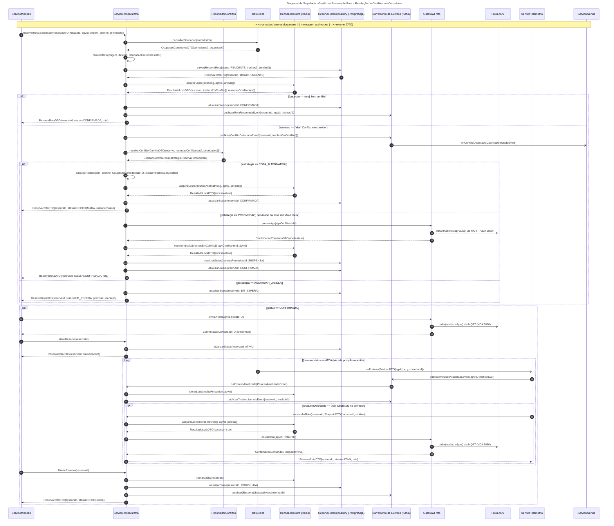
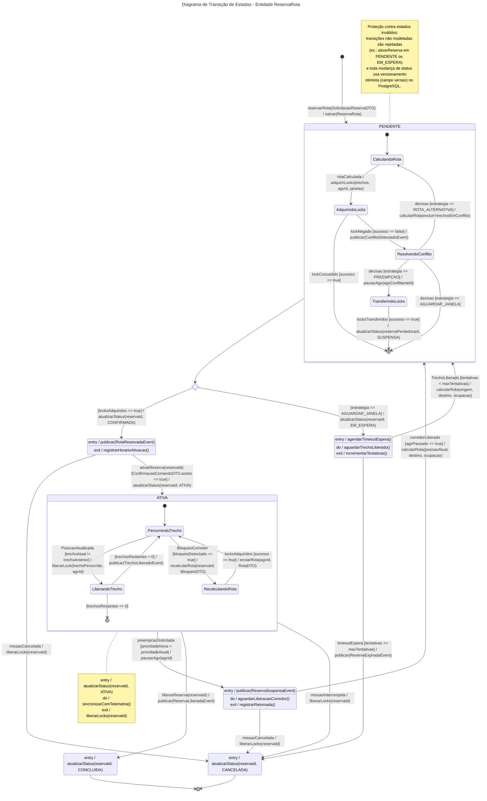

# Logística de Entregas Autônomas (AGVs) — Dossiê de Arquitetura Viva

> **APS 2 — Modelagem de Software** · Engenharia de Software · UniSenai
> **Docente:** Sidney L. da Silva · **Aluno:** Fabio Rocha · **Branch:** `fabio`
> **Projeto da equipe:** Sistema de Orquestração de Entregas Autônomas (Allan Camargo, Alyson Hian, Fabio Rocha, Laura Rosa, Jhonatan )

| | |
|---|---|
| **Funcionalidade crítica** | Gestão de Reserva de Rota e Resolução de Conflitos em Corredores |
| **Visão de domínio** | Reserva de Rota e Segurança Operacional |
| **Entidade de domínio principal** | `ReservaRota` |
| **Abordagem** | Diagrams-as-Code (Mermaid) e Models-as-Code (C4-PlantUML), versionados no Git |

---

## 1. A funcionalidade

Vários AGVs compartilham os mesmos corredores do parque industrial. Antes de iniciar uma missão, o **Serviço de Reserva de Rota** calcula o trajeto e **reserva cada trecho de corredor para um único AGV em uma janela de tempo**. Se dois AGVs disputarem o mesmo trecho, o sistema detecta o **conflito** e o resolve por uma de três estratégias:

| Estratégia | Quando | Efeito |
|---|---|---|
| `ROTA_ALTERNATIVA` | Existe caminho livre que evita os trechos em conflito | Recalcula a rota e reserva os novos trechos |
| `PREEMPCAO` | A nova missão tem prioridade maior que a do AGV que ocupa o trecho | Pausa o AGV conflitante, transfere os locks e suspende a reserva dele (`SUSPENSA`) |
| `AGUARDAR_JANELA` | Nenhuma das anteriores é possível | A reserva fica `EM_ESPERA` até um `TrechoLiberado` ou até expirar |

Durante o trajeto, a reserva é **sincronizada com a telemetria**: cada posição recebida libera o trecho já percorrido, e um bloqueio no corredor dispara o recálculo da rota com o AGV em movimento.

**Casos de uso relacionados** (diagrama de casos de uso da equipe): *Rotear missão*, *Reservar rota*, *Recalcular rota* (extend), *Acompanhar posição em tempo real*, *Interromper missão*, *Emitir alertas operacionais*.

### Regras de negócio

- **RN01:** um trecho, em uma janela de tempo, pertence a no máximo uma `ReservaRota`.
- **RN02:** a reserva é tudo-ou-nada; não existe reserva parcial de rota.
- **RN03:** só uma reserva `CONFIRMADA` pode ser enviada ao AGV e passar para `ATIVA`.
- **RN04:** a preempção só ocorre quando `prioridadeNova > prioridadeAtual` e após o AGV conflitante confirmar a pausa.
- **RN05:** todo trecho percorrido é liberado imediatamente; ao concluir ou cancelar, todos os locks da reserva são liberados.
- **RN06:** todo conflito gera o evento `ConflitoDetectado` e um alerta ao Operador Logístico.

### Estrutura do repositório

```
Logistica-AGVs/
├── docs/
│   ├── architecture/
│   │   ├── workspace.dsl         <-- C4 Nível 2 (Contêineres) em C4-PlantUML
│   │   └── adr-0001.md           <-- Registro de Decisão Arquitetural
│   └── diagrams/
│       ├── sequencia.mmd         <-- Diagrama de Sequência (Mermaid)
│       ├── atividades.mmd        <-- Diagrama de Atividades com raias (Mermaid)
│       └── estados.mmd           <-- Máquina de Estados da ReservaRota (Mermaid)
└── README.md                     <-- Este documento
```

---

## 2. Artefato 1 — Diagrama de Sequência

Fonte: [`docs/diagrams/sequencia.mmd`](docs/diagrams/sequencia.mmd)

- **Síncrono bloqueante:** `->>` · **Assíncrono / mensageria (Kafka, MQTT):** `-)` · **Retorno com DTO:** `-->>`
- **Fragmentos combinados:** `alt` (sem conflito × conflito), `alt` aninhado (três estratégias), `opt` (reserva confirmada, bloqueio no corredor) e `loop` (sincronização de telemetria).
- **DTOs:** `SolicitacaoReservaDTO`, `OcupacaoCorredoresDTO`, `ResultadoLockDTO`, `ConflitoDTO`, `DecisaoConflitoDTO`, `ReservaRotaDTO`, `ConfirmacaoComandoDTO`, `RotaDTO`, `BloqueioDTO`.



### Operações públicas por linha de vida

Regra de consistência: toda mensagem recebida por uma linha de vida corresponde a uma operação pública da sua interface.

| Interface (linha de vida) | Operações públicas |
|---|---|
| `ServicoReservaRota` | `reservarRota(SolicitacaoReservaDTO): ReservaRotaDTO` · `ativarReserva(reservaId): ReservaRotaDTO` · `recalcularRota(reservaId, BloqueioDTO): ReservaRotaDTO` · `liberarReserva(reservaId): ReservaRotaDTO` · `onPosicaoAtualizada(PosicaoAtualizadaEvent): void` · `calcularRota(origem, destino, OcupacaoCorredoresDTO): RotaDTO` |
| `ResolvedorConflitos` | `resolverConflito(ConflitoDTO): DecisaoConflitoDTO` |
| `RtlsClient` | `consultarOcupacao(corredorIds): OcupacaoCorredoresDTO` |
| `TrechoLockStore` (Redis) | `adquirirLocks(trechos, agvId, janelas): ResultadoLockDTO` · `transferirLocks(trechos, agvOrigem, agvDestino): ResultadoLockDTO` · `liberarLock(trechoId, agvId): void` · `liberarLocks(reservaId): void` |
| `ReservaRotaRepository` (PostgreSQL) | `salvar(ReservaRota): ReservaRotaDTO` · `atualizarStatus(reservaId, StatusReserva): void` |
| `GatewayFrota` | `enviarRota(agvId, RotaDTO): ConfirmacaoComandoDTO` · `pausarAgv(agvId): ConfirmacaoComandoDTO` |
| `Barramento de Eventos` (Kafka) | `publicar(Evento): void` |
| `ServicoTelemetria` | `onPosicao(PosicaoDTO): void` |
| `ServicoAlertas` | `onConflitoDetectado(ConflitoDetectadoEvent): void` |
| `Frota AGV` | `order(nodes, edges)` · `instantAction(stopPause)` (VDA 5050 via MQTT) |

---

## 3. Artefato 2 — Diagrama de Atividades com Raias

Fonte: [`docs/diagrams/atividades.mmd`](docs/diagrams/atividades.mmd)

- **5 raias:** Serviço de Missões · Serviço de Reserva de Rota · Serviço de Alertas / Operador · Gateway da Frota / AGV (hardware) · RTLS / Telemetria (externo).
- **Guardas mutuamente exclusivas:** `[sucesso == true] / [sucesso == false]`, as três estratégias `[estrategia == ...]`, `[bloqueioDetectado == true / false]`, `[trechosRestantes > 0] / [trechosRestantes == 0]`.
- **Fork/Join 1:** no conflito, o alerta ao operador e a resolução do conflito correm em paralelo.
- **Fork/Join 2:** com a reserva `ATIVA`, o AGV percorre os trechos enquanto, em paralelo, a telemetria sincroniza a posição e libera os trechos percorridos.
- Barras de fork/join são os nós pretos; início é o círculo preenchido e fim é o círculo duplo.

```mermaid
---
title: Diagrama de Atividades com Raias - Gestão de Reserva de Rota e Resolução de Conflitos em Corredores
---
flowchart TB

    subgraph L1["Serviço de Missões"]
        INI((" "))
        M1["Solicitar reserva de rota<br/>reservarRota(SolicitacaoReservaDTO)"]
        M2["Enviar rota ao AGV<br/>enviarRota(agvId, RotaDTO)"]
        M3["Ativar reserva<br/>ativarReserva(reservaId)"]
        M4["Solicitar liberação da reserva<br/>liberarReserva(reservaId)"]
        M5["Aguardar evento TrechoLiberado"]
        FIM(((" ")))
    end

    subgraph L2["Serviço de Reserva de Rota"]
        R1["Consultar ocupação dos corredores<br/>consultarOcupacao(corredorIds)"]
        R2["Calcular rota<br/>calcularRota(origem, destino, ocupacao)"]
        R3["Registrar ReservaRota<br/>status = PENDENTE"]
        R4["Adquirir locks atômicos dos trechos<br/>adquirirLocks(trechos, agvId, janelas)"]
        D1{"Locks adquiridos?"}
        R5["Confirmar reserva (status = CONFIRMADA)<br/>e publicar RotaReservada"]
        FK1[" "]
        R6["Publicar ConflitoDetectado"]
        R7["Resolver conflito por prioridade<br/>resolverConflito(ConflitoDTO)"]
        JN1[" "]
        D2{"Estratégia de resolução?"}
        R8["Calcular rota alternativa<br/>excluindo trechos em conflito"]
        R9["Solicitar pausa do AGV conflitante<br/>pausarAgv(agvConflitanteId)"]
        R10["Transferir locks e suspender<br/>reserva perdedora (SUSPENSA)"]
        R11["Marcar reserva<br/>status = EM_ESPERA"]
        R12["Atualizar reserva<br/>status = ATIVA"]
        R13["Recalcular rota e readquirir locks<br/>recalcularRota(reservaId, BloqueioDTO)"]
        R14["Liberar lock do trecho percorrido<br/>e publicar TrechoLiberado"]
        D4{"Trechos restantes?"}
        FK2[" "]
        JN2[" "]
        R15["Liberar todos os locks, status = CONCLUIDA<br/>e publicar ReservaLiberada"]
    end

    subgraph L3["Serviço de Alertas / Operador"]
        A1["Emitir alerta de conflito<br/>em corredor ao Operador"]
    end

    subgraph L4["Gateway da Frota / AGV (Hardware)"]
        G1["Pausar AGV conflitante<br/>instantAction stopPause (VDA 5050)"]
        G2["Publicar order ao AGV<br/>MQTT (VDA 5050)"]
        G3["AGV percorre os trechos<br/>reservados até o destino"]
        G4["Enviar nova rota ao AGV<br/>MQTT (VDA 5050)"]
    end

    subgraph L5["RTLS / Telemetria (Externo)"]
        T0["Fornecer ocupação dos corredores<br/>OcupacaoCorredoresDTO"]
        T1["Publicar posição do AGV<br/>PosicaoAtualizada"]
        D3{"Bloqueio detectado<br/>no corredor?"}
    end

    %% Solicitação e cálculo
    INI --> M1 --> R1 --> T0 --> R2 --> R3 --> R4 --> D1

    %% Decisão de conflito
    D1 -->|"[sucesso == true]"| R5
    D1 -->|"[sucesso == false]"| FK1

    %% Fork: alerta e resolução em paralelo
    FK1 --> R6 --> A1 --> JN1
    FK1 --> R7 --> JN1
    JN1 --> D2

    D2 -->|"[estrategia == ROTA_ALTERNATIVA]"| R8 --> R4
    D2 -->|"[estrategia == PREEMPCAO]"| R9 --> G1 --> R10 --> R5
    D2 -->|"[estrategia == AGUARDAR_JANELA]"| R11 --> M5 --> R4

    %% Envio e ativação
    R5 --> M2 --> G2 --> M3 --> R12 --> FK2

    %% Fork: trajeto do AGV em paralelo com a sincronização de telemetria
    FK2 --> G3 --> JN2
    FK2 --> T1 --> D3
    D3 -->|"[bloqueioDetectado == true]"| R13 --> G4 --> T1
    D3 -->|"[bloqueioDetectado == false]"| R14 --> D4
    D4 -->|"[trechosRestantes > 0]"| T1
    D4 -->|"[trechosRestantes == 0]"| JN2

    %% Join e conclusão
    JN2 --> M4 --> R15 --> FIM

    classDef bar fill:#000,stroke:#000,color:#000;
    classDef inicio fill:#000,stroke:#000;
    classDef decisao fill:#fff8dc,stroke:#b8860b;
    class FK1,JN1,FK2,JN2 bar;
    class INI,FIM inicio;
    class D1,D2,D3,D4 decisao;
```



---

## 4. Artefato 3 — Máquina de Estados da `ReservaRota`

Fonte: [`docs/diagrams/estados.mmd`](docs/diagrams/estados.mmd)

- **Estado inicial** `[*]` e **estados terminais** `CONCLUIDA` e `CANCELADA`.
- **Estados compostos:** `PENDENTE` (CalculandoRota, AdquirindoLocks, ResolvendoConflito, TransferindoLocks) e `ATIVA` (PercorrendoTrecho, LiberandoTrecho, RecalculandoRota).
- **Sintaxe formal `Gatilho [Guarda] / Ação()`**, por exemplo `lockNegado [sucesso == false] / publicar(ConflitoDetectadoEvent)` e `preempcaoSolicitada [prioridadeNova > prioridadeAtual] / pausarAgv(agvId)`.
- **Ações internas `entry / do / exit`** em `CONFIRMADA`, `EM_ESPERA`, `SUSPENSA`, `CONCLUIDA`, `CANCELADA` e, por nota, em `ATIVA`.
- **Proteção contra estados corrompidos:** transições não modeladas são rejeitadas e cada mudança de status usa versionamento otimista (coluna `versao`).



---

## 5. Artefato 4 — Visão de Contêineres C4 (Nível 2)

Fonte (Models-as-Code, C4-PlantUML): [`docs/architecture/workspace.dsl`](docs/architecture/workspace.dsl)

Os conectores explicitam tecnologia e protocolo: REST/HTTPS (JSON), WebSocket (WSS), gRPC (HTTP/2), MQTT 5 (VDA 5050), Kafka, RESP (Redis), JDBC e o protocolo nativo do PostgreSQL.

Para gerar a imagem a partir do `.dsl` (conteúdo PlantUML):

```bash
plantuml -tsvg docs/architecture/workspace.dsl
```

Visualização renderizada no GitHub (o mesmo modelo, transcrito para o C4 do Mermaid):

```mermaid
C4Container
    title C4 Nível 2 (Contêineres) - Orquestração de AGVs | Foco: Reserva de Rota e Resolução de Conflitos em Corredores

    Person(supervisor, "Supervisor de Operações", "Define políticas de prioridade entre missões e acompanha indicadores de conflitos")
    Person(operador, "Operador Logístico", "Monitora missões, reservas de rota ativas e conflitos em corredores")

    System_Ext(corporativo, "Sistema Corporativo (ERP/WMS)", "Origina solicitações de transporte e recebe a notificação de conclusão")
    System_Ext(frota, "Frota AGV", "Veículos autônomos compatíveis com VDA 5050 que percorrem os trechos reservados")
    System_Ext(rtls, "Infraestrutura de Localização (RTLS)", "Fornece posição em tempo real e ocupação dos corredores do parque industrial")

    System_Boundary(orq, "Sistema de Orquestração de Entregas Autônomas") {
        Container(web, "Portal de Operações", "React 18 / TypeScript (SPA)", "Mapa de corredores, reservas de rota ativas, conflitos e alertas")
        Container(api, "API Gateway / BFF", "Node.js 20 / NestJS", "Ponto único de entrada: validação de tokens, autorização por perfil e push de atualizações em tempo real")
        Container(idp, "Provedor de Identidade", "Keycloak 25", "Autenticação OIDC/OAuth 2.0 e perfis Supervisor/Operador")
        Container(integracao, "Serviço de Integração Corporativa", "Java 21 / Spring Boot 3", "Recebe solicitações do Sistema Corporativo e notifica a origem na conclusão (webhooks)")

        Container(missoes, "Serviço de Missões", "Java 21 / Spring Boot 3", "Planeja e executa missões; solicita, ativa e libera a ReservaRota de cada missão")
        Container(despacho, "Serviço de Despacho e Alocação", "Java 21 / Spring Boot 3", "Aloca o AGV à missão e redistribui missões em caso de falha")
        Container(roteamento, "Serviço de Reserva de Rota", "Python 3.12 / FastAPI", "Calcula a rota, reserva trechos com lock distribuído, detecta e resolve conflitos em corredores (rota alternativa, espera ou preempção por prioridade) e libera trechos percorridos")
        Container(telemetria, "Serviço de Rastreamento e Telemetria", "Go 1.22", "Consome posições do RTLS, detecta bloqueios/obstáculos em corredores e calcula indicadores")
        Container(alertas, "Serviço de Alertas e Notificações", "Node.js 20", "Emite alertas operacionais (conflito em corredor, bloqueio de rota, reserva expirada)")
        Container(gatewayFrota, "Gateway da Frota AGV", "Go 1.22", "Traduz rotas e comandos (enviar rota, pausar) para VDA 5050 e converte status dos AGVs em eventos")

        ContainerQueue(mqtt, "Broker MQTT", "Eclipse Mosquitto 2", "Tópicos VDA 5050 (order, instantActions, state) e tópicos de posição do RTLS")
        ContainerQueue(broker, "Barramento de Eventos", "Apache Kafka 3.7", "Eventos: RotaReservada, ConflitoDetectado, TrechoLiberado, ReservaLiberada, PosicaoAtualizada, BloqueioCorredor")
        ContainerDb(dbOper, "Banco Operacional", "PostgreSQL 16", "Schemas por serviço: missoes, frota e rotas (reservas_rota, trechos_reservados, conflitos)")
        ContainerDb(dbHist, "Banco de Rastreabilidade", "TimescaleDB 2.14 (PostgreSQL 16)", "Histórico de posições, conflitos resolvidos e indicadores")
        ContainerDb(cache, "Locks de Trechos e Estado", "Redis 7", "Locks atômicos por trecho/janela de tempo (SET NX PX + Lua) e posição atual dos AGVs")
    }

    Rel(supervisor, web, "Define prioridades e consulta indicadores de conflito", "HTTPS")
    Rel(operador, web, "Monitora reservas, conflitos e missões", "HTTPS")
    Rel(web, idp, "Autentica usuário", "OIDC / HTTPS")
    Rel(web, api, "Chamadas de API e atualizações em tempo real", "REST/HTTPS (JSON) + WebSocket (WSS)")
    Rel(api, idp, "Valida tokens JWT", "OIDC / HTTPS")

    Rel(corporativo, integracao, "Envia solicitação de transporte", "REST/HTTPS (JSON)")
    Rel(integracao, corporativo, "Notifica conclusão da missão", "Webhook HTTPS (JSON)")
    Rel(integracao, missoes, "Registra solicitação", "REST/HTTP (JSON)")

    Rel(api, missoes, "Comandos de missão", "REST/HTTP (JSON)")
    Rel(api, roteamento, "Consulta reservas e conflitos ativos", "REST/HTTP (JSON)")
    Rel(api, telemetria, "Consulta posição, histórico e indicadores", "REST/HTTP (JSON)")

    Rel(missoes, despacho, "Solicita alocação de AGV", "REST/HTTP (JSON)")
    Rel(missoes, roteamento, "reservarRota / ativarReserva / liberarReserva", "REST/HTTP (JSON)")
    Rel(missoes, gatewayFrota, "Envia rota reservada ao AGV", "gRPC (HTTP/2)")
    Rel(missoes, dbOper, "Lê e grava missões", "JDBC")
    Rel(despacho, dbOper, "Lê e grava frota e alocações", "JDBC")

    Rel(roteamento, rtls, "Consulta ocupação dos corredores", "REST/HTTPS (JSON)")
    Rel(roteamento, cache, "Adquire, transfere e libera locks de trechos", "RESP (TCP)")
    Rel(roteamento, dbOper, "Persiste ReservaRota e conflitos", "PostgreSQL wire protocol (psycopg 3)")
    Rel(roteamento, gatewayFrota, "Envia rota recalculada / pausa AGV preemptado", "gRPC (HTTP/2)")

    BiRel(gatewayFrota, mqtt, "Publica order/instantActions, assina state", "MQTT 5 (VDA 5050)")
    BiRel(frota, mqtt, "Publica state, assina order", "MQTT 5 (VDA 5050)")
    Rel(rtls, mqtt, "Publica posições dos AGVs", "MQTT 5")
    Rel(telemetria, mqtt, "Assina posições do RTLS", "MQTT 5")

    Rel(telemetria, cache, "Atualiza posição atual", "RESP (TCP)")
    Rel(telemetria, dbHist, "Grava histórico e indicadores", "PostgreSQL wire protocol (pgx)")
    Rel(telemetria, roteamento, "recalcularRota (bloqueio/obstáculo)", "gRPC (HTTP/2)")
    Rel(telemetria, api, "Push de posição em tempo real", "gRPC server streaming")

    Rel(roteamento, broker, "Publica RotaReservada, ConflitoDetectado, TrechoLiberado, ReservaLiberada", "Kafka protocol (TCP)")
    Rel(telemetria, broker, "Publica PosicaoAtualizada, BloqueioCorredor", "Kafka protocol (TCP)")
    Rel(gatewayFrota, broker, "Publica eventos da frota", "Kafka protocol (TCP)")
    Rel(broker, roteamento, "Consome PosicaoAtualizada (libera trechos percorridos)", "Kafka protocol (TCP)")
    Rel(broker, alertas, "Consome ConflitoDetectado, BloqueioCorredor", "Kafka protocol (TCP)")
    Rel(broker, telemetria, "Consome ConflitoDetectado (histórico)", "Kafka protocol (TCP)")
    Rel(broker, despacho, "Consome falhas de AGV", "Kafka protocol (TCP)")
    Rel(broker, integracao, "Consome MissaoConcluida", "Kafka protocol (TCP)")
    Rel(alertas, api, "Envia alertas ao portal", "gRPC server streaming")

    UpdateLayoutConfig($c4ShapeInRow="4", $c4BoundaryInRow="1")
```



---

## 6. Artefato 5 — ADR 0001

[**ADR 0001 — Reserva atômica de trechos de corredor com locks distribuídos no Redis**](docs/architecture/adr-0001.md) · Status: **Aprovado**

Resumo: os trechos são reservados no **Redis 7** com locks por trecho e janela de tempo (`SET NX PX`), adquiridos de forma **atômica tudo-ou-nada por script Lua**, com **fencing token** contra instâncias com lock vencido. O **PostgreSQL 16** continua como fonte da verdade do ciclo de vida da `ReservaRota`, com versionamento otimista. A ADR compara alternativas (locks do PostgreSQL, restrição de exclusão, Redlock, etcd/ZooKeeper, partições Kafka) e registra os riscos aceitos com suas mitigações.

---

## 7. Consistência entre os modelos

| Conceito | Sequência | Atividades | Estados | C4 | ADR |
|---|---|---|---|---|---|
| Reserva atômica dos trechos | `adquirirLocks` → `ResultadoLockDTO` | Decisão `[sucesso == true / false]` | `PENDENTE.AdquirindoLocks` | Reserva de Rota → Redis 7 (RESP) | Decisão principal |
| Detecção de conflito | `alt [sucesso == false]` + `ConflitoDetectadoEvent` | Fork 1 (alerta ∥ resolução) | `lockNegado [sucesso == false]` | Kafka → Alertas | Força 1 |
| Rota alternativa | `alt [ROTA_ALTERNATIVA]` | `[estrategia == ROTA_ALTERNATIVA]` | `ResolvendoConflito → CalculandoRota` | — | Alternativas |
| Preempção | `pausarAgv` + `transferirLocks` | `[estrategia == PREEMPCAO]` | `→ TransferindoLocks`; `ATIVA → SUSPENSA` | Reserva de Rota → Gateway (gRPC) | Item 3 da decisão |
| Espera | `status = EM_ESPERA` | `[estrategia == AGUARDAR_JANELA]` | `EM_ESPERA` (entry/do/exit) | — | Risco de indisponibilidade |
| Ativação | `ativarReserva` | Atualizar reserva `ATIVA` | `CONFIRMADA → ATIVA` | Missões → Reserva de Rota (REST) | — |
| Sincronização de telemetria | `loop` + `onPosicaoAtualizada` + `liberarLock` | Fork 2 (trajeto ∥ telemetria) | `ATIVA.LiberandoTrecho` | Kafka → Reserva de Rota | Força 4 |
| Bloqueio no corredor | `opt [bloqueioDetectado]` + `recalcularRota` | `[bloqueioDetectado == true]` | `ATIVA.RecalculandoRota` | Telemetria → Reserva de Rota (gRPC) | Força 3 |
| Conclusão | `liberarReserva` → `CONCLUIDA` | Liberar todos os locks | `ATIVA → CONCLUIDA → [*]` | — | — |
