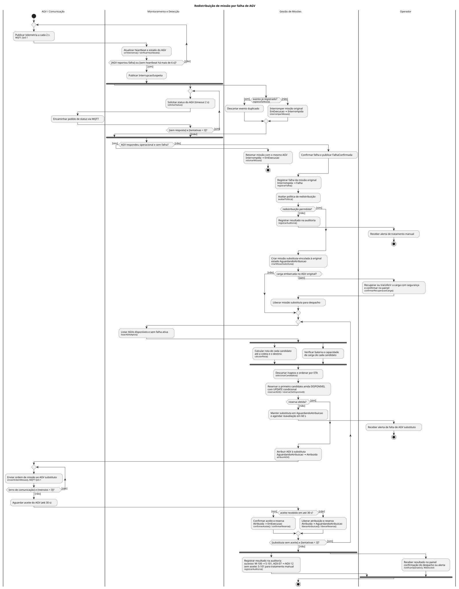
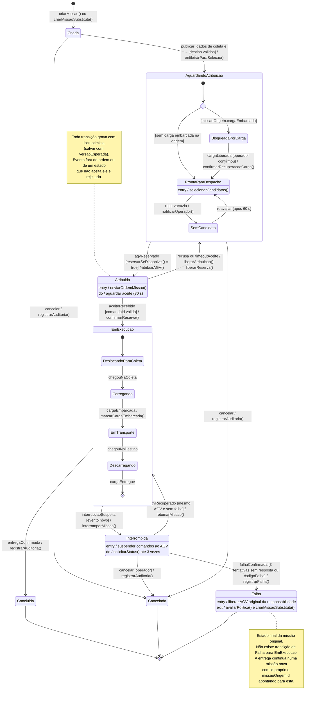
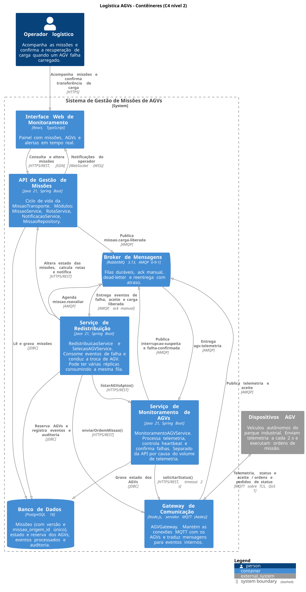

# Redistribuição de Missão por Falha de AGV

**APS 2 — Dossiê de Arquitetura Viva e Modelagem Comportamental as-Code**
Modelagem de Software · Engenharia de Software, 4º período · UniSenai
Aluno: Allan Camargo

## Sumário

1. [Problema](#1-problema)
2. [Objetivo da funcionalidade](#2-objetivo-da-funcionalidade)
3. [Contexto e escopo](#3-contexto-e-escopo)
4. [Regras de negócio e invariantes](#4-regras-de-negócio-e-invariantes)
5. [Contratos públicos dos serviços](#5-contratos-públicos-dos-serviços)
6. [Diagrama de sequência](#6-diagrama-de-sequência)
7. [Diagrama de atividades](#7-diagrama-de-atividades)
8. [Diagrama de estados](#8-diagrama-de-estados)
9. [Visão C4 de contêineres](#9-visão-c4-de-contêineres)
10. [ADR 0001](#10-adr-0001)
11. [Matriz de rastreabilidade](#11-matriz-de-rastreabilidade)
12. [Como visualizar e validar](#12-como-visualizar-e-validar)
13. [Considerações finais](#13-considerações-finais)

## 1. Problema

No parque industrial, os materiais são levados de um ponto a outro por AGVs (veículos guiados automaticamente). Cada transporte é uma `MissaoTransporte` atribuída a um único AGV.

Um AGV pode parar no meio do caminho por pane mecânica, bateria crítica ou perda de comunicação. Quando isso acontece, a entrega fica parada e alguém precisa assumir. O problema é fazer essa troca sem perder o histórico da missão original, sem deixar a entrega com dois AGVs ao mesmo tempo e sem mandar outro veículo buscar uma carga que ainda está em cima do AGV quebrado.

## 2. Objetivo da funcionalidade

Detectar a falha do AGV, encerrar a missão original como `Falha` e continuar a entrega numa **missão substituta**, com identidade própria e ligada à original, executada por outro AGV elegível.

A entidade principal é a `MissaoTransporte`. A transição crítica é **`Interrompida → Falha`**.

## 3. Contexto e escopo

**Dentro do escopo**

- detecção por telemetria e por timeout de heartbeat;
- política de tolerância antes de confirmar a falha;
- avaliação da política de redistribuição;
- seleção, reserva e despacho do AGV substituto;
- tratamento de carga embarcada, falta de candidatos e erro de comunicação;
- notificação do operador e auditoria.

**Fora do escopo**

- planejamento de rotas em si (o `RotaService` é tratado como caixa-preta que devolve viabilidade, distância e energia estimada);
- criação das missões originais e o fluxo normal de entrega;
- implementação do sistema. O trabalho é só de modelagem.

**Estrutura do repositório**

```text
aps2-allan-camargo/
├── docs/
│   ├── architecture/
│   │   ├── adr-0001.md        ADR da mensageria
│   │   ├── container.puml     C4 nível 2 (fonte)
│   │   └── container.svg      C4 nível 2 (gerado)
│   └── diagrams/
│       ├── sequencia.mmd      sequência (Mermaid)
│       ├── atividades.puml    atividades com raias (fonte)
│       ├── atividades.svg     atividades com raias (gerado)
│       └── estados.mmd        estados da MissaoTransporte (Mermaid)
└── README.md
```

**Escolha das ferramentas**

| Diagrama | Ferramenta | Por quê |
|---|---|---|
| Sequência | Mermaid `sequenceDiagram` | O GitHub renderiza direto e tem `alt`, `loop`, `break`, `opt` e mensagem assíncrona. |
| Estados | Mermaid `stateDiagram-v2` | O GitHub renderiza direto e suporta estado composto e `<<choice>>`. |
| Atividades | PlantUML | O Mermaid não tem raias nem barra de Fork/Join. Por isso o arquivo é `.puml` e não `.mmd`. |
| C4 | C4-PlantUML | A biblioteca C4 já vem dentro do PlantUML (`!include <C4/C4_Container>`), então renderiza sem internet. O C4 do Mermaid ainda é experimental. |

Os arquivos PlantUML usam `!pragma layout smetana`, que é o layout interno do PlantUML, para não depender do Graphviz instalado.

## 4. Regras de negócio e invariantes

### Atores

| Ator | Responsabilidade |
|---|---|
| Operador logístico | Acompanha o painel, recebe alertas, confirma a transferência de carga e assume os casos que não podem ser redistribuídos. |
| AGV | Envia telemetria a cada 2 s, responde a pedidos de status e aceita ou recusa ordens de missão. |
| Sistema (serviços) | Detecta a falha, decide se redistribui, escolhe o substituto e mantém o estado das missões. |

### Entidades

| Entidade | O que guarda |
|---|---|
| `MissaoTransporte` | id, estado, AGV responsável, ponto de coleta, destino, peso, `cargaEmbarcada`, `missaoOrigemId` (só na substituta), `versao` para lock otimista. |
| `AGV` | id, estado (`DISPONIVEL`, `RESERVADO`, `EM_MISSAO`, `EM_FALHA`, `MANUTENCAO`), posição, bateria, capacidade, último heartbeat. |
| `ReservaAGV` | id, AGV, missão, status (`ATIVA`, `CONFIRMADA`, `LIBERADA`) e validade (30 s). |
| `EventoProcessado` | id do evento já tratado, para descartar repetições. |
| `RegistroAuditoria` | o que aconteceu com a missão original e a substituta, com horário e AGVs envolvidos. |

### Estados da `MissaoTransporte`

`Criada`, `AguardandoAtribuicao` (subestados `BloqueadaPorCarga`, `ProntaParaDespacho`, `SemCandidato`), `Atribuida`, `EmExecucao` (subestados `DeslocandoParaColeta`, `Carregando`, `EmTransporte`, `Descarregando`), `Interrompida`, `Falha`, `Concluida` e `Cancelada`.

`Falha`, `Concluida` e `Cancelada` são finais.

### Eventos

| Evento | Quem gera | Efeito principal |
|---|---|---|
| `agv.telemetria` | Gateway | Atualiza heartbeat e estado do AGV. |
| `missao.interrupcao-suspeita` | Monitoramento | `EmExecucao → Interrompida`. |
| `agv.falha-confirmada` | Monitoramento | `Interrompida → Falha` e início da redistribuição. |
| `missao.carga-liberada` | API de Missões | Substituta sai de `BloqueadaPorCarga`. |
| `missao.aceite` | Gateway | `Atribuida → EmExecucao` na substituta. |
| `missao.reavaliar` | Redistribuição | Nova tentativa de seleção depois de 60 s. |

### Quando um AGV é considerado indisponível

- reportou `codigoFalha` na telemetria;
- ficou mais de 6 s sem heartbeat (3 ciclos perdidos) e não respondeu a 3 pedidos de status;
- está em `EM_FALHA` ou `MANUTENCAO`;
- já está `RESERVADO` ou `EM_MISSAO`.

### Política de redistribuição

A redistribuição só acontece se:

- a missão original estiver em `Falha`;
- a entrega não tiver sido cancelada;
- o prazo da entrega ainda não tiver vencido;
- a cadeia de missões dessa entrega tiver menos de 3 redistribuições.

Se alguma condição falhar, a entrega vai para tratamento manual do operador.

### Elegibilidade e critério de seleção do substituto

Um AGV é elegível quando:

1. está `DISPONIVEL` e sem falha ativa;
2. a capacidade de carga é maior ou igual ao peso da missão;
3. o `RotaService` encontra rota viável até o ponto de coleta e depois até o destino;
4. a bateria cobre a energia estimada da rota com **20% de margem**.

Entre os elegíveis, a ordem é pelo menor ETA até o ponto de coleta. A reserva é feita no primeiro da lista que ainda estiver livre.

### Regra de continuidade

A missão original **não volta** a `EmExecucao` em outro AGV. Ela termina em `Falha`, e a entrega continua numa nova `MissaoTransporte` com id próprio e `missaoOrigemId` apontando para a original. Assim dá para saber, pelo histórico, que AGV fez qual parte da entrega.

O ponto de coleta da substituta depende de onde está a carga:

- carga ainda no ponto de coleta: a substituta usa o mesmo ponto de coleta;
- carga em cima do AGV que falhou: a substituta fica em `BloqueadaPorCarga` até o operador confirmar que a carga foi retirada ou transferida com segurança (`confirmarRecuperacaoCarga`).

### Política de falhas e recuperação

| Situação | Tratamento |
|---|---|
| Queda curta de comunicação | Missão vai para `Interrompida`. Se o AGV responder bem dentro das 3 tentativas, volta para `EmExecucao` com o mesmo AGV. |
| Evento repetido do broker | `registrarSeNovo(eventoId)` devolve `false` e o evento é descartado. |
| Dois processos querendo o mesmo AGV | A reserva é um `UPDATE` condicional. Quem perde tenta o próximo candidato. |
| Nenhum candidato elegível | Substituta fica em `SemCandidato`, operador é avisado e uma reavaliação é agendada para 60 s depois. |
| Erro ao enviar a ordem | O gateway reenvia até 3 vezes (MQTT QoS 1). Se não der, a tentativa conta como falha de despacho. |
| AGV não aceita em 30 s ou recusa | Reserva e atribuição são liberadas e o próximo candidato é tentado (até 3 tentativas). |
| Aceite chega depois do timeout | O `comandoId` já foi invalidado, então o aceite é ignorado. |
| Serviço cai no meio do processo | O evento só recebe ack depois de gravado. Se cair antes, o RabbitMQ entrega de novo. |

### Invariantes

| # | Invariante | Como é garantida |
|---|---|---|
| I1 | Uma entrega tem no máximo uma missão ativa (`Atribuida`, `EmExecucao` ou `Interrompida`) por vez. | A substituta só é criada depois que a original chega em `Falha`. |
| I2 | Um AGV tem no máximo uma reserva ou missão ativa. | `reservarSeDisponivel` com `UPDATE ... WHERE estado = 'DISPONIVEL'`. |
| I3 | Missão em `Falha`, `Concluida` ou `Cancelada` não muda mais de estado. | Máquina de estados sem transição de saída e lock otimista na gravação. |
| I4 | Cada missão original tem no máximo uma substituta. | `UNIQUE(missao_origem_id)` e `buscarSubstitutaDe` antes de criar. |
| I5 | Substituta de missão com carga embarcada não é despachada sem confirmação do operador. | Subestado `BloqueadaPorCarga` só sai com `confirmarRecuperacaoCarga`. |
| I6 | Um evento é aplicado uma única vez. | Tabela de eventos processados e ack manual. |

## 5. Contratos públicos dos serviços

Toda mensagem do diagrama de sequência corresponde a uma operação desta seção, no serviço que recebe a mensagem.

### Serviços e operações

**`MonitoramentoAGVService`** (Serviço de Monitoramento)

| Operação | Retorno | Observação |
|---|---|---|
| `onTelemetria(TelemetriaDTO)` | `void` | Consumidor de `agv.telemetria`. |
| `verificarHeartbeats()` | `void` | Agendado a cada 2 s. |
| `listarAGVsAptos(FiltroAGVDTO)` | `AGVStatusDTO[]` | REST. |

**`RedistribuicaoService`** (Serviço de Redistribuição)

| Operação | Retorno | Observação |
|---|---|---|
| `onInterrupcaoSuspeita(InterrupcaoSuspeitaEvent)` | `void` | Consumidor. |
| `onFalhaConfirmada(FalhaConfirmadaEvent)` | `void` | Consumidor. |
| `onCargaLiberada(CargaLiberadaEvent)` | `void` | Consumidor. |
| `onAceiteMissao(AceiteMissaoDTO)` | `void` | Consumidor. |
| `avaliarPolitica(MissaoDTO)` | `DecisaoRedistribuicaoDTO` | |

**`SelecaoAGVService`** (Serviço de Redistribuição)

| Operação | Retorno | Observação |
|---|---|---|
| `selecionarCandidatos(CriterioSelecaoDTO)` | `CandidatoDTO[]` | Ordenados por ETA. |
| `reservarAGV(CandidatoDTO[], missaoId)` | `ReservaDTO` | Vazio se nenhum reservar. |
| `confirmarReserva(reservaId)` | `ReservaDTO` | |
| `liberarReserva(reservaId)` | `void` | |

**`MissaoService`** (API de Gestão de Missões)

| Operação | Retorno | Observação |
|---|---|---|
| `criarMissao(NovaMissaoDTO)` | `MissaoDTO` | Fluxo normal, fora do escopo. |
| `enfileirarParaSelecao(missaoId)` | `MissaoDTO` | `Criada → AguardandoAtribuicao`. |
| `interromperMissao(missaoId, MotivoInterrupcaoDTO)` | `MissaoDTO` | `EmExecucao → Interrompida`. |
| `retomarMissao(missaoId)` | `MissaoDTO` | `Interrompida → EmExecucao`, mesmo AGV. |
| `registrarFalha(missaoId, FalhaDTO)` | `MissaoDTO` | `Interrompida → Falha`. |
| `criarMissaoSubstituta(missaoOrigemId)` | `MissaoDTO` | Idempotente. |
| `confirmarRecuperacaoCarga(missaoId, ConfirmacaoCargaDTO)` | `MissaoDTO` | Chamado pela Interface Web. |
| `atribuirAGV(missaoId, agvId, reservaId)` | `MissaoDTO` | `AguardandoAtribuicao → Atribuida`. |
| `confirmarAceite(missaoId, AceiteMissaoDTO)` | `MissaoDTO` | `Atribuida → EmExecucao`. Idempotente. |
| `liberarAtribuicao(missaoId, motivo)` | `MissaoDTO` | `Atribuida → AguardandoAtribuicao`. |
| `marcarCargaEmbarcada(missaoId)` | `MissaoDTO` | `Carregando → EmTransporte`. |
| `cancelarMissao(missaoId, motivo)` | `MissaoDTO` | Gera o evento `cancelar` da máquina de estados. |

**`RotaService`** (API de Gestão de Missões)

| Operação | Retorno |
|---|---|
| `calcularRota(origem, pontoColeta, destino)` | `RotaDTO` |

**`NotificacaoService`** (API de Gestão de Missões)

| Operação | Retorno | Observação |
|---|---|---|
| `notificarOperador(NotificacaoDTO)` | `void` | Push via WebSocket para a Interface Web. |

**`AGVGateway`** (Gateway de Comunicação)

| Operação | Retorno | Observação |
|---|---|---|
| `solicitarStatus(agvId, timeout)` | `StatusAGVDTO` | Devolve `SEM_RESPOSTA` no timeout. |
| `enviarOrdemMissao(OrdemMissaoDTO)` | `EnvioDTO` | Publica a ordem via MQTT QoS 1, com até 3 reenvios. |

**Mensagens MQTT entre AGV e Gateway** (não são operações de serviço, são tópicos do dispositivo)

| Sentido | Mensagem | Conteúdo |
|---|---|---|
| AGV → Gateway | `telemetria` | mesmo conteúdo do `TelemetriaDTO` |
| AGV → Gateway | `status` | resposta ao pedido de status |
| AGV → Gateway | `aceite(comandoId)` | aceite ou recusa da ordem |
| Gateway → AGV | `pedido de status` | pedido com timeout de 2 s |
| Gateway → AGV | `ordem de missão` | conteúdo do `OrdemMissaoDTO` |

**Repositórios**

| Repositório | Operação | Retorno |
|---|---|---|
| `MissaoRepository` | `salvar(missao, versaoEsperada)` | `MissaoTransporte` (falha se a versão mudou) |
| `MissaoRepository` | `buscarSubstitutaDe(missaoOrigemId)` | `MissaoTransporte` ou vazio |
| `AGVRepository` | `reservarSeDisponivel(agvId, missaoId, ttl)` | `boolean` |
| `EventoRepository` | `registrarSeNovo(eventoId)` | `boolean` |
| `EventoRepository` | `registrarAuditoria(AuditoriaDTO)` | `void` |

O broker só tem duas operações nos diagramas: `publicar(topico, evento [, atraso])` e `ack(evento)`.

### DTOs e eventos

| DTO | Campos principais |
|---|---|
| `TelemetriaDTO` | agvId, missaoId, timestamp, posicao, bateriaPct, cargaEmbarcada, codigoFalha? |
| `StatusAGVDTO` | agvId, situacao (`OPERACIONAL`, `COM_FALHA`, `SEM_RESPOSTA`), bateriaPct, posicao |
| `InterrupcaoSuspeitaEvent` | eventoId, missaoId, agvId, motivo (`FALHA_REPORTADA`, `HEARTBEAT_EXPIRADO`), detectadoEm |
| `FalhaConfirmadaEvent` | eventoId, missaoId, agvId, codigoFalha?, tentativasContato |
| `CargaLiberadaEvent` | eventoId, missaoId, operadorId |
| `MotivoInterrupcaoDTO` | tipo, detectadoEm |
| `FalhaDTO` | codigoFalha?, origem (`AGV`, `HEARTBEAT`), confirmadaEm |
| `MissaoDTO` | id, estado, agvId, missaoOrigemId?, cargaEmbarcada, cargaLiberada, versao |
| `DecisaoRedistribuicaoDTO` | permitida, motivo |
| `CriterioSelecaoDTO` | missaoId, pontoColeta, destino, pesoKg, zona |
| `FiltroAGVDTO` | zona, estado |
| `AGVStatusDTO` | agvId, estado, posicao, bateriaPct, capacidadeKg |
| `RotaDTO` | viavel, distanciaM, energiaEstimadaPct, etaS |
| `CandidatoDTO` | agvId, etaS, rota |
| `ReservaDTO` | reservaId, agvId, missaoId, status, expiraEm |
| `OrdemMissaoDTO` | comandoId, missaoId, agvId, pontoColeta, destino |
| `EnvioDTO` | comandoId, enviadoEm |
| `AceiteMissaoDTO` | comandoId, missaoId, agvId, aceito, respondidoEm |
| `ConfirmacaoCargaDTO` | operadorId, procedimento, confirmadoEm |
| `NotificacaoDTO` | tipo, severidade, missaoId, mensagem |
| `AuditoriaDTO` | missaoOrigemId, missaoSubstitutaId?, agvOriginal, agvSubstituto?, resultado |
| `NovaMissaoDTO` | pontoColeta, destino, pesoKg, prazo |

## 6. Diagrama de sequência

Fonte: [docs/diagrams/sequencia.mmd](docs/diagrams/sequencia.mmd)

O exemplo usado é a missão M-100, que estava com o AGV-07. Ele falha e a entrega passa para o AGV-12 através da substituta S-101. As caixas agrupam os serviços pelo contêiner onde rodam, o mesmo agrupamento da visão C4.

Notação usada:

- `->>` é chamada síncrona: quem chama espera a resposta;
- `-)` é mensagem assíncrona (evento no RabbitMQ ou MQTT);
- `-->>` é retorno, sempre com o DTO;
- `--)` é o ack para o broker.

Pontos que valem destacar:

- A missão passa por `Interrompida` antes de `Falha`. Uma queda rápida de rede não deve gerar redistribuição, por isso o `break` de falha transitória.
- Os dois `registrarSeNovo` tratam a reentrega de eventos pelo broker.
- O ack do `FalhaConfirmadaEvent` só sai depois que a substituta foi gravada. Daí em diante, o andamento depende do estado da S-101 no banco, não da mensagem.
- O `loop` de reserva com `opt reservado = false` mostra a disputa entre duas redistribuições pelo mesmo AGV.

```mermaid
sequenceDiagram
    autonumber

    participant AGV1 as AGV-07 (original)
    participant AGV2 as AGV-12 (substituto)
    participant GW as AGVGateway
    participant BRK as Broker (RabbitMQ)
    box transparent Serviço de Monitoramento
        participant MON as MonitoramentoAGVService
    end
    box transparent Serviço de Redistribuição
        participant RED as RedistribuicaoService
        participant SEL as SelecaoAGVService
        participant AGVR as AGVRepository
        participant EREP as EventoRepository
    end
    box transparent API de Gestão de Missões
        participant MIS as MissaoService
        participant MREP as MissaoRepository
        participant ROT as RotaService
        participant NOT as NotificacaoService
    end
    participant WEB as Interface Web
    actor OP as Operador

    loop A cada 2 s enquanto M-100 está EmExecucao com AGV-07
        AGV1 -) GW: telemetria [MQTT, QoS 1]
        GW -) BRK: publicar("agv.telemetria", TelemetriaDTO)
        BRK -) MON: onTelemetria(TelemetriaDTO)
    end

    Note over AGV1: Pane mecânica, bateria crítica ou perda de rádio

    alt AGV reporta falha (TelemetriaDTO.codigoFalha preenchido)
        AGV1 -) GW: telemetria com codigoFalha [MQTT]
        GW -) BRK: publicar("agv.telemetria", TelemetriaDTO)
        BRK -) MON: onTelemetria(TelemetriaDTO)
    else Nenhum heartbeat há mais de 6 s (3 ciclos perdidos)
        MON ->> MON: verificarHeartbeats()
    end

    MON -) BRK: publicar("missao.interrupcao-suspeita", InterrupcaoSuspeitaEvent)
    BRK -) RED: onInterrupcaoSuspeita(InterrupcaoSuspeitaEvent)
    RED ->>+ EREP: registrarSeNovo(eventoId)
    EREP -->>- RED: boolean novo
    alt novo = false (evento reentregue pelo broker)
        RED --) BRK: ack(InterrupcaoSuspeitaEvent) sem reprocessar
    else novo = true
        RED ->>+ MIS: interromperMissao(M-100, MotivoInterrupcaoDTO)
        MIS ->>+ MREP: salvar(M-100, versaoEsperada)
        MREP -->>- MIS: MissaoTransporte [versao + 1]
        MIS -->>- RED: MissaoDTO [M-100, estado = Interrompida]
        RED --) BRK: ack(InterrupcaoSuspeitaEvent)
    end

    Note over MON,GW: Tolerância: até 3 tentativas de contato, timeout de 2 s cada
    loop tentativa = 1..3, enquanto não houver resposta
        MON ->>+ GW: solicitarStatus(AGV-07, timeout = 2 s)
        GW -) AGV1: pedido de status [MQTT]
        alt AGV responde dentro do timeout
            AGV1 --) GW: status [MQTT]
            GW -->> MON: StatusAGVDTO [operacional ou com falha]
        else Timeout
            GW -->>- MON: StatusAGVDTO [SEM_RESPOSTA]
        end
    end

    break AGV respondeu operacional e sem falha (falha transitória)
        Note over MON,MIS: Mesmo AGV retoma M-100 (retomarMissao), sem redistribuição
    end

    MON -) BRK: publicar("agv.falha-confirmada", FalhaConfirmadaEvent)
    BRK -) RED: onFalhaConfirmada(FalhaConfirmadaEvent)
    RED ->>+ EREP: registrarSeNovo(eventoId)
    EREP -->>- RED: boolean novo
    break novo = false (evento duplicado)
        RED --) BRK: ack(FalhaConfirmadaEvent) sem reprocessar
    end

    RED ->>+ MIS: registrarFalha(M-100, FalhaDTO)
    MIS ->>+ MREP: salvar(M-100, versaoEsperada)
    MREP -->>- MIS: MissaoTransporte [versao + 1]
    MIS -->>- RED: MissaoDTO [M-100, estado = Falha, cargaEmbarcada]
    Note over MIS: AGV-07 perde a responsabilidade pela entrega

    RED ->> RED: avaliarPolitica(MissaoDTO)
    RED -->> RED: DecisaoRedistribuicaoDTO
    break permitida = false (entrega cancelada, prazo expirado ou 3 redistribuições)
        RED -) NOT: notificarOperador(NotificacaoDTO [tratamento manual])
        NOT -) WEB: alerta [WebSocket]
        RED --) BRK: ack(FalhaConfirmadaEvent)
    end

    RED ->>+ MIS: criarMissaoSubstituta(M-100)
    MIS ->>+ MREP: buscarSubstitutaDe(M-100)
    MREP -->>- MIS: vazio (ou S-101 já existente, devolvida sem criar outra)
    MIS ->>+ MREP: salvar(S-101 com missaoOrigemId = M-100, versao 0)
    MREP -->>- MIS: MissaoTransporte [S-101]
    MIS -->>- RED: MissaoDTO [S-101, estado = AguardandoAtribuicao, missaoOrigemId = M-100]
    Note over MIS,MREP: UNIQUE(missao_origem_id): no máximo uma substituta por missão original
    RED --) BRK: ack(FalhaConfirmadaEvent)

    opt cargaEmbarcada = true (carga está fisicamente no AGV-07)
        RED -) NOT: notificarOperador(NotificacaoDTO [recuperação de carga necessária])
        NOT -) WEB: alerta [WebSocket]
        WEB -->> OP: S-101 bloqueada até transferência segura
        OP ->> WEB: confirma transferência da carga
        WEB ->>+ MIS: confirmarRecuperacaoCarga(S-101, ConfirmacaoCargaDTO)
        MIS -->>- WEB: MissaoDTO [S-101, cargaLiberada = true]
        MIS -) BRK: publicar("missao.carga-liberada", CargaLiberadaEvent)
        BRK -) RED: onCargaLiberada(CargaLiberadaEvent)
    end

    loop tentativa de despacho = 1..3, até o aceite
        RED ->>+ SEL: selecionarCandidatos(CriterioSelecaoDTO)
        SEL ->>+ MON: listarAGVsAptos(FiltroAGVDTO)
        MON -->>- SEL: AGVStatusDTO[] [DISPONIVEL, sem falha ativa]
        loop para cada AGV listado
            SEL ->>+ ROT: calcularRota(posicaoAGV, pontoColeta, destino)
            ROT -->>- SEL: RotaDTO [viavel, distancia, energiaEstimada]
        end
        Note over SEL: Descarta se rota inviável, capacidade menor que o peso<br/>ou bateria menor que energiaEstimada + 20%
        SEL -->>- RED: CandidatoDTO[] ordenados por ETA

        RED ->>+ SEL: reservarAGV(CandidatoDTO[], S-101)
        loop para cada candidato, até obter a reserva
            SEL ->>+ AGVR: reservarSeDisponivel(agvId, S-101, ttl = 30 s)
            AGVR -->>- SEL: boolean reservado
            opt reservado = false
                Note over SEL,AGVR: Outro processo reservou o AGV antes, tenta o próximo
            end
        end
        SEL -->>- RED: ReservaDTO [AGV-12] ou vazio

        break ReservaDTO vazio (nenhum AGV elegível ou todos já reservados)
            RED -) NOT: notificarOperador(NotificacaoDTO [sem AGV substituto])
            NOT -) WEB: alerta [WebSocket]
            RED -) BRK: publicar("missao.reavaliar", S-101, atraso = 60 s)
        end

        RED ->>+ MIS: atribuirAGV(S-101, AGV-12, reservaId)
        MIS ->>+ MREP: salvar(S-101, versaoEsperada)
        MREP -->>- MIS: MissaoTransporte [versao + 1]
        MIS -->>- RED: MissaoDTO [S-101, estado = Atribuida]

        RED ->>+ GW: enviarOrdemMissao(OrdemMissaoDTO)
        GW -->>- RED: EnvioDTO [comandoId]
        loop reenvio enquanto não houver PUBACK do AGV (máx. 3)
            GW -) AGV2: ordem de missão S-101 [MQTT, QoS 1]
        end

        alt AGV-12 aceita em até 30 s
            AGV2 -) GW: aceite(comandoId) [MQTT]
            GW -) BRK: publicar("missao.aceite", AceiteMissaoDTO)
            BRK -) RED: onAceiteMissao(AceiteMissaoDTO)
            RED ->>+ MIS: confirmarAceite(S-101, AceiteMissaoDTO)
            MIS -->>- RED: MissaoDTO [S-101, estado = EmExecucao]
            RED ->>+ SEL: confirmarReserva(reservaId)
            SEL -->>- RED: ReservaDTO [CONFIRMADA]
        else Recusa, timeout de aceite ou erro de comunicação
            RED ->>+ MIS: liberarAtribuicao(S-101, motivo)
            MIS -->>- RED: MissaoDTO [S-101, estado = AguardandoAtribuicao]
            RED ->>+ SEL: liberarReserva(reservaId)
            SEL -->>- RED: void
            Note over RED: Aceite que chegar depois é descartado (comandoId já invalidado)
        end
    end

    alt S-101 em EmExecucao
        RED ->>+ EREP: registrarAuditoria(AuditoriaDTO [M-100 para S-101, AGV-07 para AGV-12])
        EREP -->>- RED: void
        RED -) NOT: notificarOperador(NotificacaoDTO [missão redistribuída])
        NOT -) WEB: atualização [WebSocket]
        WEB -->> OP: painel mostra M-100 em Falha e S-101 em execução
    else 3 tentativas sem aceite
        RED ->>+ EREP: registrarAuditoria(AuditoriaDTO [redistribuição sem sucesso])
        EREP -->>- RED: void
        RED -) NOT: notificarOperador(NotificacaoDTO [tratamento manual de S-101])
        NOT -) WEB: alerta [WebSocket]
    end
```



## 7. Diagrama de atividades

Fonte: [docs/diagrams/atividades.puml](docs/diagrams/atividades.puml) · imagem gerada: [docs/diagrams/atividades.svg](docs/diagrams/atividades.svg)



O diagrama tem quatro raias: AGV / Comunicação, Monitoramento e Detecção, Gestão de Missões e Operador. Separei o Operador numa raia própria porque ele participa de verdade do fluxo: é quem libera a carga embarcada.

Os três pares de Fork/Join foram usados só onde as atividades realmente rodam ao mesmo tempo:

1. **Interromper a missão || tentar contato com o AGV.** São serviços diferentes reagindo ao mesmo evento. O Join é obrigatório porque a decisão "retomar ou falhar" precisa da missão já em `Interrompida` e do resultado das tentativas.
2. **Calcular rota || verificar bateria e capacidade.** O cálculo de rota é uma chamada remota e a verificação é local. Nenhuma depende da outra, e o descarte só pode acontecer com as duas prontas.
3. **Registrar auditoria || notificar operador.** As duas são independentes. A notificação já é assíncrona no diagrama de sequência.

As decisões têm guardas `[sim]`/`[não]` sobre uma mesma condição, então são mutuamente exclusivas. A escolha do candidato e a reserva ficam dentro de um mesmo `repeat`, com no máximo 3 tentativas de despacho, igual ao `loop` da sequência.

## 8. Diagrama de estados

Fonte: [docs/diagrams/estados.mmd](docs/diagrams/estados.mmd)



A transição crítica é:

```text
Interrompida --> Falha : falhaConfirmada [3 tentativas sem resposta ou codigoFalha] / registrarFalha()
```

O evento é o `FalhaConfirmadaEvent`. A guarda garante que a tolerância foi esgotada ou que o próprio AGV reportou a falha. O efeito grava a falha com lock otimista. O `entry` de `Falha` libera o AGV original da responsabilidade, e o `exit` dispara a política e a criação da substituta.

Algumas decisões do modelo:

- **`Falha` é final.** Não existe `Falha → EmExecucao`. Se existisse, a mesma missão poderia ficar com dois AGVs ao longo do tempo e o histórico se perderia (regra de continuidade).
- **A substituta começa em `Criada`** pelo mesmo caminho de qualquer missão. Dentro de `AguardandoAtribuicao`, o `<<choice>>` manda para `BloqueadaPorCarga` quando a origem estava com carga embarcada.
- **`Interrompida → EmExecucao`** só vale para o mesmo AGV (`[mesmo AGV e sem falha]`). É a única volta permitida.
- **Transições de exceção:** recusa ou timeout de aceite (`Atribuida → AguardandoAtribuicao`), interrupção, falha e cancelamento.
- **Proteção contra transições inválidas:** o serviço só aplica um evento se existir transição saindo do estado atual, e a gravação com `versaoEsperada` rejeita eventos que chegaram fora de ordem.

O Mermaid não aceita `entry`/`do`/`exit` em estado composto. Por isso as ações internas ficam nos estados simples: `Atribuida`, `Interrompida`, `Falha` e `ProntaParaDespacho`.

## 9. Visão C4 de contêineres

Fonte: [docs/architecture/container.puml](docs/architecture/container.puml) · imagem gerada: [docs/architecture/container.svg](docs/architecture/container.svg)



| Contêiner | Tecnologia | Responsabilidade |
|---|---|---|
| Interface Web de Monitoramento | React, TypeScript | Painel do operador. Recebe alertas por WebSocket. |
| API de Gestão de Missões | Java 21, Spring Boot | Ciclo de vida da missão. Módulos `MissaoService`, `RotaService`, `NotificacaoService`. |
| Serviço de Monitoramento de AGVs | Java 21, Spring Boot | Telemetria, heartbeat e confirmação de falha. |
| Serviço de Redistribuição | Java 21, Spring Boot | Política, seleção, reserva e despacho. |
| Gateway de Comunicação | Node.js, servidor MQTT (Aedes) | Conexão MQTT com os AGVs e tradução para eventos internos. |
| Broker de Mensagens | RabbitMQ 3.13 | Filas duráveis, ack manual, dead-letter e mensagem com atraso. |
| Banco de Dados | PostgreSQL 16 | Missões, AGVs e reservas, eventos processados e auditoria. |

Sobre o que virou contêiner e o que ficou como módulo:

- **`RotaService` e `NotificacaoService`** são módulos da API. Não têm carga nem ciclo de deploy próprios, então não justificam processo separado.
- **Monitoramento** é separado porque recebe telemetria de toda a frota a cada 2 s e precisa escalar sem afetar a API.
- **Redistribuição** é separada porque é um consumidor de eventos que pode ter várias réplicas na mesma fila. Se cair, os eventos esperam no broker, e a API continua atendendo o operador.
- **Gateway** isola o protocolo dos AGVs. Os serviços Java falam só AMQP e REST.

Protocolos: HTTPS/REST entre a Web e a API e entre os serviços; WebSocket para notificações; MQTT sobre TLS (QoS 1) entre os AGVs e o Gateway; AMQP com o RabbitMQ; JDBC com o PostgreSQL.

## 10. ADR 0001

Documento completo: [docs/architecture/adr-0001.md](docs/architecture/adr-0001.md)

**Decisão:** usar RabbitMQ (AMQP) entre os serviços e MQTT/TLS só entre os AGVs e o Gateway, com filas duráveis e ack manual depois da gravação no banco.

A entrega das mensagens é **pelo menos uma vez**, não exatamente uma vez. O efeito único é obtido no banco com cinco mecanismos que aparecem nos diagramas: deduplicação por `eventoId`, lock otimista na missão, `UNIQUE(missao_origem_id)`, reserva por `UPDATE` condicional e `comandoId` para descartar aceite atrasado.

Alternativas descartadas: REST síncrono com polling (perde eventos quando um serviço cai), Kafka (pesado de operar para esse tamanho de frota e sem dead-letter e reentrega com atraso nativos) e um broker MQTT para tudo (sem fila durável por consumidor com ack manual).

As principais consequências são a consistência eventual no painel, o RabbitMQ como ponto crítico (precisa de cluster) e a limpeza periódica da tabela de eventos processados.

## 11. Matriz de rastreabilidade

| Passo / evento | Operação | Sequência | Atividades | Estados | C4 | ADR |
|---|---|---|---|---|---|---|
| Telemetria e heartbeat | `onTelemetria`, `verificarHeartbeats` | `loop` inicial e `alt` de detecção | `repeat` na raia Monitoramento | `EmExecucao` | AGVs → Gateway → Broker → Monitoramento | MQTT só na ponta |
| Interrupção suspeita | `interromperMissao` | `alt novo = true` | 1º Fork, ramo Gestão | `EmExecucao → Interrompida` | Monitoramento → Broker → Redistribuição → API | ack manual |
| Evento repetido | `registrarSeNovo` | `alt` / `break novo = false` | "evento já registrado?" | sem mudança de estado | Redistribuição → Banco | deduplicação por `eventoId` |
| Tolerância | `solicitarStatus` | `loop tentativa = 1..3` | 1º Fork, ramo Monitoramento | `do` de `Interrompida` | Monitoramento → Gateway | timeout de 2 s, 3 tentativas |
| Falha transitória | `retomarMissao` | `break` de falha transitória | "AGV respondeu operacional?" [sim] | `Interrompida → EmExecucao` | Redistribuição → API | |
| Falha confirmada | `registrarFalha` | após `FalhaConfirmadaEvent` | "Registrar falha da missão original" | **`Interrompida → Falha`** | Redistribuição → API → Banco | lock otimista |
| Política | `avaliarPolitica` | `break permitida = false` | "redistribuição permitida?" | `exit` de `Falha` | Serviço de Redistribuição | |
| Missão substituta | `criarMissaoSubstituta`, `buscarSubstitutaDe` | bloco da S-101 | "Criar missão substituta" | `[*] → Criada → AguardandoAtribuicao` | API → Banco | `UNIQUE(missao_origem_id)` |
| Carga embarcada | `confirmarRecuperacaoCarga`, `onCargaLiberada` | `opt cargaEmbarcada = true` | raia Operador | `BloqueadaPorCarga → ProntaParaDespacho` | Operador → Web → API → Broker | |
| Seleção | `listarAGVsAptos`, `calcularRota`, `selecionarCandidatos` | `loop` por AGV listado | 2º Fork/Join | `entry` de `ProntaParaDespacho` | Redistribuição → Monitoramento e API | |
| Reserva concorrente | `reservarAGV`, `reservarSeDisponivel` | `loop` com `opt reservado = false` | "Reservar ... UPDATE condicional" | `AguardandoAtribuicao → Atribuida` | Redistribuição → Banco | reserva por `UPDATE` condicional |
| Sem candidato | `notificarOperador`, `publicar(missao.reavaliar)` | `break ReservaDTO vazio` | "reserva obtida?" [não] | `ProntaParaDespacho ⇄ SemCandidato` | Redistribuição → Broker | reentrega com atraso |
| Despacho e erro de comunicação | `atribuirAGV`, `enviarOrdemMissao` | `loop reenvio` | `repeat` de reenvio na raia AGV | `entry` de `Atribuida` | Redistribuição → Gateway → AGVs | MQTT QoS 1 |
| Aceite | `onAceiteMissao`, `confirmarAceite`, `confirmarReserva` | `alt AGV-12 aceita` | "aceite recebido em até 30 s?" [sim] | `Atribuida → EmExecucao` | AGVs → Gateway → Broker → Redistribuição | `comandoId` |
| Recusa ou timeout | `liberarAtribuicao`, `liberarReserva` | `else` do aceite | "aceite recebido?" [não] | `Atribuida → AguardandoAtribuicao` | Redistribuição → API | aceite atrasado descartado |
| Resultado | `registrarAuditoria`, `notificarOperador` | `alt` final | 3º Fork/Join | estado final da S-101 | API → Web (WebSocket) | auditoria |

## 12. Como visualizar e validar

**No GitHub:** os blocos Mermaid deste README aparecem renderizados. Os diagramas PlantUML aparecem pelos SVGs gerados a partir dos `.puml`.

**Localmente**, com Node.js e Java 17 ou superior:

```bash
# Mermaid (sequência e estados)
npx -y @mermaid-js/mermaid-cli@11.4.2 -i docs/diagrams/sequencia.mmd -o /tmp/sequencia.svg
npx -y @mermaid-js/mermaid-cli@11.4.2 -i docs/diagrams/estados.mmd -o /tmp/estados.svg

# PlantUML (atividades e C4). Gera os .svg ao lado dos fontes
curl -sSL -o plantuml.jar https://github.com/plantuml/plantuml/releases/download/v1.2024.7/plantuml-1.2024.7.jar
java -jar plantuml.jar -tsvg -failfast2 docs/diagrams/atividades.puml docs/architecture/container.puml
```

Os comandos terminam com código diferente de zero se houver erro de sintaxe. Não é preciso ter Graphviz, porque os `.puml` usam o layout `smetana`.

No VS Code também dá para ver usando as extensões *Markdown Preview Mermaid Support* e *PlantUML*.

Sempre que um `.puml` mudar, o `.svg` correspondente precisa ser gerado de novo e commitado junto.

## 13. Considerações finais

O ponto que mais influenciou a modelagem foi a regra de não reaproveitar a missão que falhou. Ela fez a máquina de estados ficar com `Falha` como estado final e obrigou a ter uma missão substituta com identidade própria, o que por sua vez trouxe a necessidade de garantir que só exista uma substituta por original.

A outra decisão importante foi aceitar que as mensagens podem chegar repetidas e resolver isso no banco, em vez de supor que o broker entrega exatamente uma vez. Por isso aparecem em todos os diagramas o `registrarSeNovo`, o lock otimista e a reserva condicional.

Ficaram de fora coisas que seriam necessárias numa implementação real, como a limpeza da tabela de eventos processados, o cluster do RabbitMQ e o planejamento de rotas. Esses pontos estão registrados como consequências na ADR.
