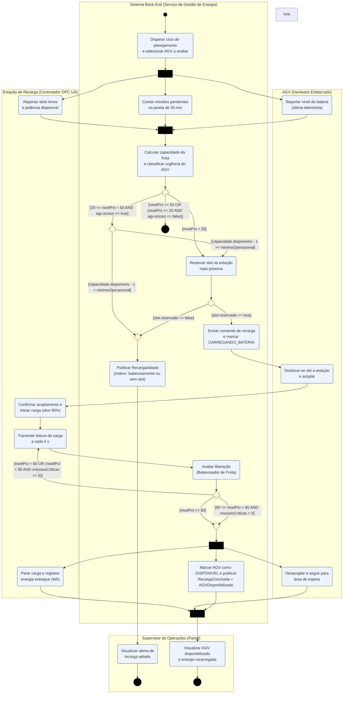
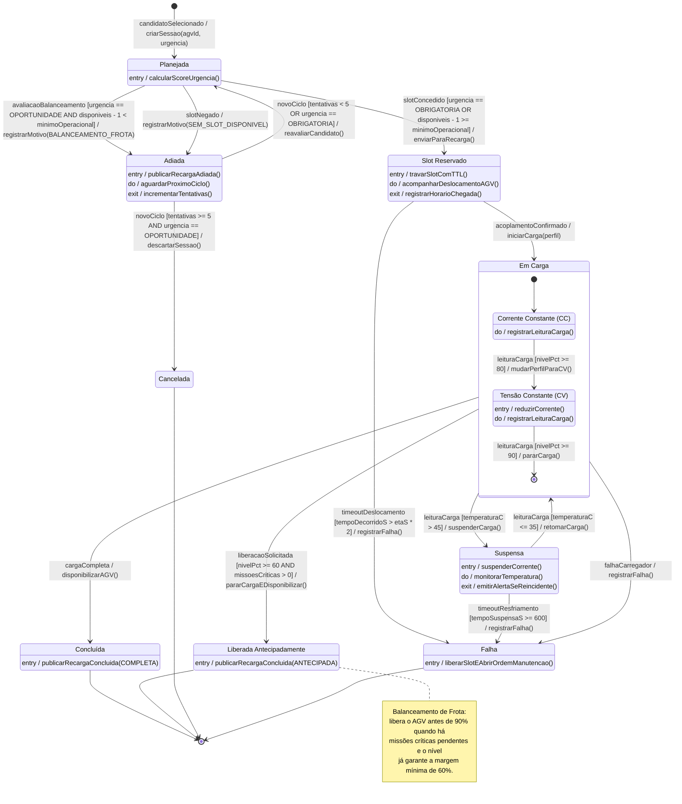

# Dossiê de Arquitetura Viva — Recarga Programada e Balanceamento de Frota

**Domínio:** Logística de Entregas Autônomas em Parques Industriais (AGVs)
**Disciplina:** Modelagem de Software — Engenharia de Software
**Autor:** Alyson Vitalino
**Base:** *Visão de Domínio Consolidada* (Sprint 1), Seção 5: Políticas de Recarregamento e de Balanceamento de Frota

> Todos os diagramas deste dossiê são escritos como código (*Diagrams as Code*). Os diagramas UML usam **Mermaid.js**, renderizado nativamente pelo GitHub nesta página. A visão C4 usa **C4-PlantUML**.
>
> Este dossiê complementa o dossiê [Despacho de Rota com Checagem de Bateria](../aps2-alyson-vitalino/README.md). Os dois usam os mesmos limiares de bateria, os mesmos contêineres e os mesmos eventos de domínio.

## Sumário

1. [A funcionalidade](#1-a-funcionalidade)
2. [Estrutura de arquivos](#2-estrutura-de-arquivos)
3. [Artefato 1 — Diagrama de Sequência](#3-artefato-1--diagrama-de-sequência)
4. [Artefato 2 — Diagrama de Atividades com Raias](#4-artefato-2--diagrama-de-atividades-com-raias)
5. [Artefato 3 — Diagrama de Transição de Estados](#5-artefato-3--diagrama-de-transição-de-estados)
6. [Artefato 4 — Visão C4 de Componentes](#6-artefato-4--visão-c4-de-componentes)
7. [Artefato 5 — ADR 0001](#7-artefato-5--adr-0001)
8. [Consistência entre os artefatos](#8-consistência-entre-os-artefatos)
9. [Notas de notação](#9-notas-de-notação)

---

## 1. A funcionalidade

**Recarga Programada e Balanceamento de Frota** decide **quais AGVs vão recarregar, quando e em qual estação**, sem que a frota disponível caia abaixo do necessário para atender a demanda. É uma funcionalidade crítica porque:

- recarregar AGVs de menos leva a baterias esgotadas no meio de missões, corredores bloqueados e missões redistribuídas;
- recarregar AGVs demais ao mesmo tempo esvazia a frota disponível, atrasa missões e para a produção;
- estações de recarga são um recurso escasso e precisam ser reservadas como os trechos de corredor.

### Fluxo resumido

1. A cada **60 s**, ou imediatamente quando chega `BateriaCriticaDetectada`, o sistema dispara um **ciclo de planejamento**.
2. Em paralelo, o sistema conta as missões pendentes (próximos 30 min), lê a última telemetria de bateria e consulta os slots livres nas estações.
3. O **Balanceador** calcula a capacidade da frota: AGVs disponíveis, mínimo operacional e vagas de recarga.
4. A **Política de Recarregamento** classifica cada AGV:
   - `nivelPct < 20`: recarga **OBRIGATÓRIA**;
   - `20 ≤ nivelPct < 50` e AGV ocioso: recarga de **OPORTUNIDADE**, só se `disponiveis − 1 ≥ minimoOperacional`;
   - demais casos: o AGV não precisa recarregar agora.
5. O sistema reserva um slot na estação mais próxima e envia o AGV. Se não houver slot, ou se a saída quebrar o balanceamento, a recarga é **adiada** para o próximo ciclo.
6. Na estação, a carga segue as fases **CC → CV** da bateria Li-ion, com leitura a cada 5 s.
7. O AGV é liberado quando a carga fica **COMPLETA** (≥ 90%) ou **ANTECIPADA** (≥ 60% com missões críticas pendentes).

### Regras e políticas aplicadas

| Regra / Política (Visão de Domínio) | Onde é aplicada |
|---|---|
| Política de Recarregamento | Classificação OBRIGATÓRIA / OPORTUNIDADE (decisão D1, `PoliticaRecarregamento`) |
| Política de Balanceamento de Frota | `disponiveis − 1 ≥ minimoOperacional`, limite de `vagasRecarga` e liberação antecipada |
| Exclusividade de Missão | AGV em `CARREGANDO_BATERIA` não recebe missões até voltar a `DISPONIVEL` |
| Segurança Operacional | Suspensão da carga por superaquecimento (`temperaturaC > 45`) |
| Continuidade | `SessaoRecarga → Falha` abre ordem de manutenção, e o ciclo seguinte reavalia a frota |

---

## 2. Estrutura de arquivos

```
aps2-alyson-vitalino-recarga/
├── docs/
│   ├── architecture/
│   │   ├── workspace.dsl         <-- C4 nível 3 (Componentes) em C4-PlantUML
│   │   └── adr-0001.md           <-- Registro de Decisão Arquitetural
│   └── diagrams/
│       ├── sequencia.mmd         <-- Diagrama de Sequência (Mermaid)
│       ├── atividades.mmd        <-- Diagrama de Atividades com raias (Mermaid)
│       └── estados.mmd           <-- Máquina de estados da SessaoRecarga (Mermaid)
└── README.md                     <-- Este documento
```

---

## 3. Artefato 1 — Diagrama de Sequência

**Fonte:** [`docs/diagrams/sequencia.mmd`](docs/diagrams/sequencia.mmd)

O diagrama tem 13 linhas de vida e três fases: diagnóstico da frota, programação das recargas e execução da carga na estação.

| Requisito | Atendimento |
|---|---|
| Chamadas síncronas bloqueantes | `->>`: chamadas locais, SQL, gRPC ao AGV Gateway, métodos OPC UA na estação |
| Chamadas assíncronas / mensageria | `-)`: job BullMQ, eventos AMQP no RabbitMQ, subscriptions OPC UA (acoplamento e leituras) |
| Fragmentos combinados | 2× `loop` (candidatos, leituras de carga), `alt/else` aninhado (balanceamento → slot) e `alt/else` de liberação |
| Retorno com DTOs | `AGVStatusDTO`, `LeituraBateriaDTO`, `DemandaDTO`, `CapacidadeFrotaDTO`, `CandidatoRecargaDTO`, `EstacaoCandidataDTO`, `SlotRecargaDTO`, `AckComandoDTO`, `AckCargaDTO`, `DecisaoLiberacaoDTO` |
| Regra de consistência | O cabeçalho do arquivo declara as operações públicas de cada linha de vida (ver [seção 8](#8-consistência-entre-os-artefatos)) |

```mermaid
sequenceDiagram
    %% =====================================================================
    %% Artefato 1 — Diagrama de Sequência
    %% Funcionalidade: Recarga Programada e Balanceamento de Frota
    %% Contexto núcleo: Orquestração de Missões
    %% Políticas aplicadas: Recarregamento e Balanceamento de Frota
    %%
    %% Convenção de setas:
    %%   ->>   chamada síncrona bloqueante (gRPC unário / SQL / chamada local)
    %%   -)    mensagem assíncrona (BullMQ / AMQP / OPC UA subscription), sem espera
    %%   -->>  retorno de dados (DTO)
    %%
    %% Limiares (coerentes com o dossiê de Despacho):
    %%   nivelPct < 20            -> recarga OBRIGATORIA
    %%   20 <= nivelPct < 50      -> recarga de OPORTUNIDADE (se a frota permitir)
    %%   nivelPct >= 90           -> carga completa, AGV liberado
    %%   nivelPct >= 60 + demanda -> liberação ANTECIPADA (balanceamento)
    %%
    %% Regra de consistência — operações públicas de cada linha de vida
    %% (toda mensagem recebida abaixo corresponde a uma destas operações):
    %%
    %%   PlanejadorRecargaService
    %%     + iniciarCicloPlanejamento(cicloId): void
    %%   FrotaRepository
    %%     + listarAGVsOperacionais(): AGVStatusDTO[]
    %%     + atualizarEstado(agvId, estado: EstadoAGV): void
    %%   TelemetriaService
    %%     + obterUltimasLeituras(agvIds[]): LeituraBateriaDTO[]
    %%     + registrarLeituraCarga(l: LeituraCargaDTO): void
    %%   BalanceadorFrotaService
    %%     + calcularCapacidadeFrota(frota: AGVStatusDTO[]): CapacidadeFrotaDTO
    %%     + avaliarLiberacao(agvId, nivelPct): DecisaoLiberacaoDTO
    %%   MissaoRepository
    %%     + contarPendentes(janelaMin): DemandaDTO
    %%   PoliticaRecarregamento (Strategy)
    %%     + priorizarCandidatos(leituras: LeituraBateriaDTO[], cap: CapacidadeFrotaDTO): CandidatoRecargaDTO[]
    %%   GeolocalizacaoService
    %%     + localizarEstacoesProximas(agvId): EstacaoCandidataDTO[]
    %%   EstacaoRecargaService
    %%     + reservarSlot(req: ReservaSlotRequestDTO): SlotRecargaDTO
    %%     + notificarAcoplamento(slotId, agvId): void
    %%     + receberLeituraCarga(l: LeituraCargaDTO): void
    %%   AGVGateway (adaptador gRPC)
    %%     + enviarParaRecarga(agvId, estacaoId): AckComandoDTO
    %%   AGVFirmware (hardware embarcado)
    %%     + irParaEstacao(estacaoId): AckComandoDTO
    %%   ControladorEstacao (hardware, OPC UA)
    %%     + iniciarCarga(p: PerfilCargaDTO): AckCargaDTO
    %%     + pararCarga(slotId): AckCargaDTO
    %%   EventBus (RabbitMQ)
    %%     + publicar(evento: DomainEvent): void
    %% =====================================================================

    autonumber

    participant JOB as AgendadorJobs<br/>(BullMQ, a cada 60 s)
    participant PLAN as PlanejadorRecargaService
    participant FREPO as FrotaRepository
    participant TEL as TelemetriaService
    participant BAL as BalanceadorFrotaService
    participant MREPO as MissaoRepository
    participant POL as PoliticaRecarregamento<br/>(Strategy)
    participant GEO as GeolocalizacaoService
    participant EST as EstacaoRecargaService
    participant GW as AGVGateway<br/>(gRPC)
    participant AGV as AGVFirmware<br/>(hardware)
    participant CTRL as ControladorEstacao<br/>(OPC UA)
    participant BUS as EventBus<br/>(RabbitMQ)

    %% ---------- Fase 1: diagnóstico da frota ----------
    JOB-)PLAN: iniciarCicloPlanejamento(cicloId)
    activate PLAN

    PLAN->>FREPO: listarAGVsOperacionais()
    FREPO-->>PLAN: AGVStatusDTO[]{agvId, estado, ocioso, missaoAtualId}

    PLAN->>TEL: obterUltimasLeituras(agvIds[])
    TEL-->>PLAN: LeituraBateriaDTO[]{agvId, nivelPct, autonomiaWh, saudePct, ts}

    PLAN->>BAL: calcularCapacidadeFrota(AGVStatusDTO[])
    activate BAL
    BAL->>MREPO: contarPendentes(janelaMin=30)
    MREPO-->>BAL: DemandaDTO{missoesPendentes, missoesCriticas}
    BAL-->>PLAN: CapacidadeFrotaDTO{disponiveis, emRecarga, minimoOperacional, vagasRecarga}
    deactivate BAL

    PLAN->>POL: priorizarCandidatos(LeituraBateriaDTO[], CapacidadeFrotaDTO)
    POL-->>PLAN: CandidatoRecargaDTO[]{agvId, nivelPct, urgencia=OBRIGATORIA|OPORTUNIDADE, score}

    %% ---------- Fase 2: programação das recargas ----------
    loop [para cada candidato, em ordem de score, enquanto capacidade.vagasRecarga > 0]

        alt [candidato.urgencia == OBRIGATORIA OR capacidade.disponiveis - 1 >= capacidade.minimoOperacional]
            PLAN->>GEO: localizarEstacoesProximas(agvId)
            GEO-->>PLAN: EstacaoCandidataDTO[]{estacaoId, distanciaM, etaS}

            PLAN->>EST: reservarSlot(ReservaSlotRequestDTO{agvId, estacoes[], janelaInicio})
            EST-->>PLAN: SlotRecargaDTO{slotId, estacaoId, reservado, inicioPrevisto}

            alt [slot.reservado == true]
                PLAN->>GW: enviarParaRecarga(agvId, estacaoId)
                activate GW
                GW->>AGV: irParaEstacao(estacaoId)
                AGV-->>GW: AckComandoDTO{aceito=true, timestamp}
                GW-->>PLAN: AckComandoDTO{aceito=true, timestamp}
                deactivate GW
                PLAN->>FREPO: atualizarEstado(agvId, CARREGANDO_BATERIA)
                PLAN-)BUS: publicar(RecargaProgramadaEvent{agvId, slotId, urgencia})
                Note over PLAN: capacidade.disponiveis -= 1<br/>capacidade.vagasRecarga -= 1
            else [slot.reservado == false]
                PLAN-)BUS: publicar(RecargaAdiadaEvent{agvId, motivo=SEM_SLOT_DISPONIVEL})
            end

        else [candidato.urgencia == OPORTUNIDADE AND capacidade.disponiveis - 1 < capacidade.minimoOperacional]
            Note over PLAN,BAL: Balanceamento: retirar este AGV deixaria a frota abaixo do mínimo
            PLAN-)BUS: publicar(RecargaAdiadaEvent{agvId, motivo=BALANCEAMENTO_FROTA})
        end
    end

    PLAN-)BUS: publicar(CicloRecargaConcluidoEvent{cicloId, programadas, adiadas})
    deactivate PLAN

    %% ---------- Fase 3: execução da carga na estação ----------
    Note over AGV,CTRL: AGV se desloca e acopla na estação reservada
    CTRL-)EST: notificarAcoplamento(slotId, agvId)
    activate EST
    EST->>CTRL: iniciarCarga(PerfilCargaDTO{slotId, correnteMaxA, alvoPct=90})
    CTRL-->>EST: AckCargaDTO{iniciada=true, timestamp}
    deactivate EST

    loop [a cada 5 s, enquanto a sessão de carga estiver ativa]
        CTRL-)EST: receberLeituraCarga(LeituraCargaDTO{slotId, agvId, nivelPct, correnteA, temperaturaC})
        activate EST
        EST-)TEL: registrarLeituraCarga(LeituraCargaDTO)
        EST->>BAL: avaliarLiberacao(agvId, nivelPct)
        BAL-->>EST: DecisaoLiberacaoDTO{liberar, tipo=COMPLETA|ANTECIPADA|NENHUMA}

        alt [decisao.liberar == true]
            Note over EST,BAL: COMPLETA: nivelPct >= 90<br/>ANTECIPADA: nivelPct >= 60 AND missoesCriticas > 0
            EST->>CTRL: pararCarga(slotId)
            CTRL-->>EST: AckCargaDTO{encerrada=true, energiaWh}
            EST->>FREPO: atualizarEstado(agvId, DISPONIVEL)
            EST-)BUS: publicar(RecargaConcluidaEvent{agvId, tipo, nivelPct, energiaWh})
            EST-)BUS: publicar(AGVDisponibilizadoEvent{agvId, nivelPct})
        else [decisao.liberar == false]
            Note over EST: Carga continua na próxima leitura
        end
        deactivate EST
    end
```



---

## 4. Artefato 2 — Diagrama de Atividades com Raias

**Fonte:** [`docs/diagrams/atividades.mmd`](docs/diagrams/atividades.mmd)

O diagrama mostra o workflow de avaliação e recarga de um AGV dentro do ciclo de planejamento.

| Requisito | Atendimento |
|---|---|
| Mínimo de 3 raias | 4 raias: **Supervisor de Operações**, **Sistema Back-End**, **AGV (Hardware)**, **Estação de Recarga (OPC UA)** |
| Decisões com guardas mutuamente exclusivas | D1 com 3 guardas (Recarregamento), D2 (Balanceamento), D3 (slot), D4 com 3 guardas (liberação). Todas são exaustivas e disjuntas |
| Fork e Join | **Fork/Join 1:** demanda ‖ bateria do AGV ‖ slots da estação (3 raias). **Fork/Join 2:** parar carga ‖ AGV desacoplar ‖ atualizar estado e publicar eventos |



---

## 5. Artefato 3 — Diagrama de Transição de Estados

**Fonte:** [`docs/diagrams/estados.mmd`](docs/diagrams/estados.mmd)

O diagrama mostra o ciclo de vida da entidade **SessaoRecarga**, que complementa a máquina de estados do `VeiculoAGV` do dossiê de Despacho. Enquanto a sessão está em *Slot Reservado*, *Em Carga* ou *Suspensa*, o AGV permanece em *Carregando Bateria*.

| Requisito | Atendimento |
|---|---|
| Estado inicial | `[*] --> Planejada : candidatoSelecionado / criarSessao(agvId, urgencia)` |
| Subestados | **Em Carga** é composto pelas fases *Corrente Constante (CC)* → *Tensão Constante (CV)* da bateria Li-ion |
| Estados terminais | **Concluída**, **Liberada Antecipadamente**, **Cancelada** e **Falha** |
| `Gatilho [Guarda] / Efeito()` | Ex.: `slotConcedido [urgencia == OBRIGATORIA OR disponiveis - 1 >= minimoOperacional] / enviarParaRecarga()` e `leituraCarga [temperaturaC > 45] / suspenderCarga()` |
| Ações internas | `entry /`, `do /`, `exit /` em *Adiada*, *Slot Reservado* e *Suspensa* (além de `entry` nos terminais e `do` nos subestados) |



---

## 6. Artefato 4 — Visão C4 de Componentes

**Fonte:** [`docs/architecture/workspace.dsl`](docs/architecture/workspace.dsl) (conteúdo em **C4-PlantUML**)

A visão de **Componentes (C4 nível 3)** dá zoom dentro do contêiner **API de Orquestração de Missões** (Node.js 20, NestJS), o mesmo contêiner da visão C4 nível 2 do dossiê de Despacho.

> O GitHub não renderiza PlantUML nativamente. Para visualizar o diagrama:
> - **Local:** `java -jar plantuml.jar -tpng docs/architecture/workspace.dsl`
> - **VS Code:** extensão *PlantUML* (jebbs.plantuml), com `Alt+D` sobre o arquivo
> - **Online:** colar o conteúdo do arquivo em <https://www.plantuml.com/plantuml>

| Componente | Tecnologia | Responsabilidade |
|---|---|---|
| PoliticaEnergiaController | NestJS REST Controller | Ajuste dos parâmetros das políticas pelo Supervisor |
| AgendadorJobs / CicloRecargaWorker | BullMQ Worker (60 s) | Dispara o ciclo e garante uma única execução por vez |
| BateriaCriticaListener | NestJS + amqplib | Antecipa o ciclo quando chega `BateriaCriticaDetectada` |
| PlanejadorRecargaService | NestJS Service | Orquestra o ciclo de planejamento |
| PoliticaRecarregamento | Strategy (TypeScript) | Classifica urgência e calcula score |
| BalanceadorFrotaService | NestJS Service | Capacidade da frota e liberação antecipada |
| EstacaoRecargaService | NestJS Service | Slots, sessões de recarga e leituras de carga |
| OpcUaEstacaoAdapter | node-opcua client | Adaptador anticorrupção para as estações |
| Frota / Missao / SessaoRecarga Repository | Prisma ORM | Persistência no PostgreSQL 16 |
| Clientes gRPC | @grpc/grpc-js + Protobuf | Telemetria, Geolocalização e AGV Gateway |
| DomainEventPublisher | amqplib (publisher confirms) | Publicação de eventos de domínio no RabbitMQ |

**Protocolos nos conectores:** REST/JSON sobre HTTPS · gRPC / HTTP/2 (Protobuf) · AMQP 0-9-1 · RESP sobre TCP 6379 (BullMQ e travas de slot) · SQL sobre TCP 5432 · OPC UA Binary sobre TCP 4840 (Basic256Sha256) · chamadas locais entre componentes.

---

## 7. Artefato 5 — ADR 0001

**Documento:** [`docs/architecture/adr-0001.md`](docs/architecture/adr-0001.md)

**ADR 0001 — Planejamento de recarga em ciclo periódico centralizado (BullMQ + Redis), com antecipação por evento de bateria crítica.** Status: **Aprovado**.

- **Contexto:** decidir a recarga de cada AGV isoladamente, a cada leitura de telemetria, causa **efeito manada** (vários AGVs saem para recarga juntos) e **condições de corrida** sobre o mínimo operacional. Um ciclo puramente periódico, por outro lado, atrasa a reação à bateria crítica.
- **Decisão:**
  - ciclo centralizado a cada 60 s, como job repetível do BullMQ, com `jobId` deduplicado e `concurrency: 1`;
  - antecipação imediata do ciclo por `BateriaCriticaDetectada`;
  - política em Strategy com parâmetros ajustáveis;
  - trava de slot no Redis com TTL.
- **Consequências:**
  - *Vantagens:* mínimo operacional garantido, fim do efeito manada, reação a bateria crítica em menos de 1 s e custo previsível.
  - *Riscos aceitos:* até 60 s de latência para recargas de oportunidade, o Redis como ponto crítico e o ciclo único como gargalo em frotas muito grandes.

---

## 8. Consistência entre os artefatos

### Operações públicas × mensagens do Diagrama de Sequência

| Linha de vida (classe / interface) | Operações públicas declaradas | Componente no C4 |
|---|---|---|
| `PlanejadorRecargaService` | `iniciarCicloPlanejamento(cicloId)` | PlanejadorRecargaService |
| `FrotaRepository` | `listarAGVsOperacionais(): AGVStatusDTO[]`, `atualizarEstado(agvId, estado)` | FrotaRepository |
| `TelemetriaService` | `obterUltimasLeituras(agvIds[]): LeituraBateriaDTO[]`, `registrarLeituraCarga(l)` | Serviço de Telemetria (via Clientes gRPC) |
| `BalanceadorFrotaService` | `calcularCapacidadeFrota(frota): CapacidadeFrotaDTO`, `avaliarLiberacao(agvId, nivelPct): DecisaoLiberacaoDTO` | BalanceadorFrotaService |
| `MissaoRepository` | `contarPendentes(janelaMin): DemandaDTO` | MissaoRepository |
| `PoliticaRecarregamento` | `priorizarCandidatos(leituras, cap): CandidatoRecargaDTO[]` | PoliticaRecarregamento |
| `GeolocalizacaoService` | `localizarEstacoesProximas(agvId): EstacaoCandidataDTO[]` | Serviço de Geolocalização (via Clientes gRPC) |
| `EstacaoRecargaService` | `reservarSlot(req): SlotRecargaDTO`, `notificarAcoplamento(slotId, agvId)`, `receberLeituraCarga(l)` | EstacaoRecargaService |
| `AGVGateway` | `enviarParaRecarga(agvId, estacaoId): AckComandoDTO` | AGV Gateway (via Clientes gRPC) |
| `AGVFirmware` | `irParaEstacao(estacaoId): AckComandoDTO` | — (hardware) |
| `ControladorEstacao` | `iniciarCarga(p): AckCargaDTO`, `pararCarga(slotId): AckCargaDTO` | Estações de Recarga (via OpcUaEstacaoAdapter) |
| `EventBus` | `publicar(evento: DomainEvent)` | RabbitMQ (via DomainEventPublisher) |

### Limiares e conceitos compartilhados

| Conceito | Sequência | Atividades | Estados | C4 | ADR |
|---|---|---|---|---|---|
| Recarga obrigatória < 20% | `urgencia == OBRIGATORIA` | D1 | `Planejada → SlotReservado` | PoliticaRecarregamento | Strategy |
| Oportunidade 20–50% + mínimo operacional | `alt` da fase 2 | D1 → D2 | `Planejada → Adiada` | BalanceadorFrotaService | Contexto (efeito manada) |
| Carga completa ≥ 90% | `alt` da fase 3 | D4 | `TensaoConstante → [*]` | EstacaoRecargaService | Strategy |
| Liberação antecipada ≥ 60% + críticas | `DecisaoLiberacaoDTO` | D4 | `EmCarga → LiberadaAntecipadamente` | BalanceadorFrotaService | Vantagens |
| Ciclo de 60 s | `AgendadorJobs` | Ação B1 | `Adiada → Planejada : novoCiclo` | CicloRecargaWorker | Decisão |
| Leitura de carga a cada 5 s | `loop` da fase 3 | Ação E3 | `do / registrarLeituraCarga()` | OpcUaEstacaoAdapter | — |

### Coerência com o dossiê de Despacho

| Elemento | Dossiê de Despacho | Este dossiê |
|---|---|---|
| Limiar mínimo de bateria | 20% para despachar | 20% para recarga obrigatória |
| Bateria crítica | `BateriaCriticaDetectada` com < 15% | O evento antecipa o ciclo de recarga |
| Fim da recarga | `CarregandoBateria → Disponível [nivelPct >= 90]` | `TensaoConstante → [*] [nivelPct >= 90]` |
| Comando ao AGV | `AGVGateway.enviarParaRecarga()` via gRPC | Mesma operação e mesmo canal (ADR 0001 do Despacho) |
| Contêiner | API de Orquestração (C4 nível 2) | Zoom em componentes da mesma API (C4 nível 3) |

---

## 9. Notas de notação

- **Seta assíncrona no Mermaid:** o enunciado cita `-\>`, mas no Mermaid a mensagem assíncrona é escrita como `-)` (seta aberta). `->>` é a chamada síncrona e `-->>` é o retorno.
- **Raias no Mermaid:** o Mermaid não tem diagrama de atividades UML nativo. As raias são `subgraph`, as barras de fork/join são nós pretos e as decisões são losangos com as guardas nos rótulos das arestas.
- **`workspace.dsl` com C4-PlantUML:** a estrutura de entrega fixa o nome `workspace.dsl`, mas o Artefato 4 exige Mermaid ou C4-PlantUML. O arquivo mantém o nome pedido e contém código C4-PlantUML.
- **Visão lógica × física:** no Diagrama de Sequência, `ControladorEstacao`, `TelemetriaService` e `EventBus` aparecem como linhas de vida diretas (visão lógica). No C4, as chamadas passam pelos adaptadores `OpcUaEstacaoAdapter`, `Clientes gRPC` e `DomainEventPublisher` (visão de componentes).
- **Validação:** os três arquivos `.mmd` foram validados com o parser oficial do Mermaid (v11).
