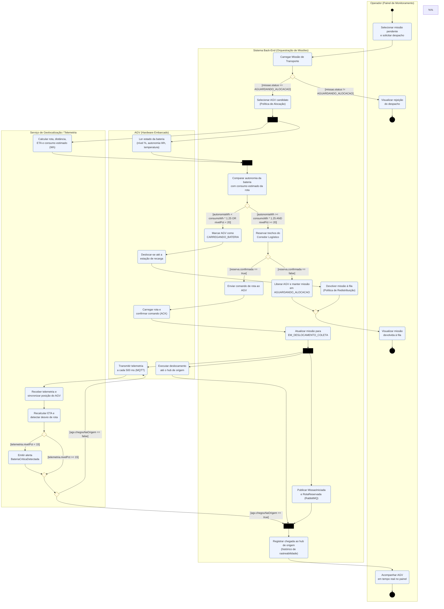
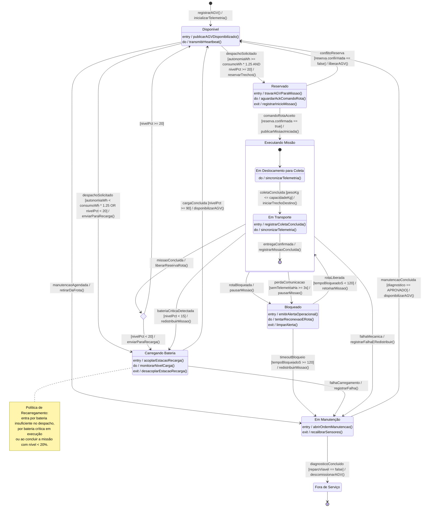

# Dossiê de Arquitetura Viva — Despacho de Rota com Checagem de Bateria e Sincronização de Telemetria

**Domínio:** Logística de Entregas Autônomas em Parques Industriais (AGVs)
**Disciplina:** Modelagem de Software — Engenharia de Software
**Autor:** Alyson Vitalino
**Base:** *Visão de Domínio Consolidada* (Sprint 1)

> Todos os diagramas deste dossiê são escritos como código (*Diagrams as Code*). Os diagramas UML usam **Mermaid.js**, renderizado nativamente pelo GitHub nesta página. A visão C4 usa **C4-PlantUML**.

## Sumário

1. [A funcionalidade](#1-a-funcionalidade)
2. [Estrutura de arquivos](#2-estrutura-de-arquivos)
3. [Artefato 1 — Diagrama de Sequência](#3-artefato-1--diagrama-de-sequência)
4. [Artefato 2 — Diagrama de Atividades com Raias](#4-artefato-2--diagrama-de-atividades-com-raias)
5. [Artefato 3 — Diagrama de Transição de Estados](#5-artefato-3--diagrama-de-transição-de-estados)
6. [Artefato 4 — Visão C4 de Contêineres](#6-artefato-4--visão-c4-de-contêineres)
7. [Artefato 5 — ADR 0001](#7-artefato-5--adr-0001)
8. [Consistência entre os artefatos](#8-consistência-entre-os-artefatos)
9. [Notas de notação](#9-notas-de-notação)

---

## 1. A funcionalidade

**Despacho de Rota com Checagem de Bateria e Sincronização de Telemetria** é o momento em que uma **Missão de Transporte** sai da fila e é entregue a um **AGV** para execução. É uma funcionalidade crítica do contexto núcleo **Orquestração de Missões**, por três motivos:

- um AGV despachado sem autonomia suficiente para no meio do corredor, bloqueia outros veículos e interrompe a cadeia produtiva;
- uma rota liberada sem **Reserva de Rota** pode colocar dois AGVs no mesmo trecho e causar uma colisão;
- sem telemetria sincronizada, a plataforma não detecta bateria crítica, desvio de rota nem perda de comunicação.

### Fluxo resumido

1. O **Operador** seleciona uma missão em `AGUARDANDO_ALOCACAO` e solicita o despacho.
2. A **Política de Alocação** escolhe um AGV candidato.
3. Em paralelo, a **Geolocalização** calcula a rota e o consumo estimado (Wh), e o **AGV** informa sua bateria em tempo real.
4. **Checagem de bateria:** o despacho só segue se `autonomiaWh >= consumoWh × 1,25` (margem de 25%) **e** `nivelPct >= 20`.
   - Se a bateria for insuficiente, o AGV vai para recarga e a missão volta à fila (**Política de Recarregamento + Redistribuição**).
5. Os trechos do **Corredor Logístico** são reservados. Se houver conflito, o AGV é liberado e a missão volta à fila.
6. O comando de rota é enviado ao AGV, que confirma (ACK). A missão passa para `EM_DESLOCAMENTO_COLETA`.
7. **Sincronização de telemetria:** a cada 500 ms o AGV publica posição e bateria. A plataforma atualiza o ETA, detecta desvios, atualiza o painel e emite `BateriaCriticaDetectada` se `nivelPct < 15`.

### Regras de negócio aplicadas

| Regra (Visão de Domínio) | Onde é aplicada |
|---|---|
| Exclusividade de Missão | AGV passa a `Reservado` antes de executar; a reserva é liberada ao final |
| Capacidade | Guarda `[pesoKg <= capacidadeKg]` na coleta |
| Segurança Operacional | Reserva de trechos antes de qualquer movimento |
| Continuidade | Redistribuição em bateria crítica, bloqueio prolongado ou falha mecânica |
| Política de Recarregamento | Limiares de 20% no despacho, 15% crítico e 90% para encerrar a recarga |

---

## 2. Estrutura de arquivos

```
aps2-alyson-vitalino/
├── docs/
│   ├── architecture/
│   │   ├── workspace.dsl         <-- C4 nível 2 (Contêineres) em C4-PlantUML
│   │   └── adr-0001.md           <-- Registro de Decisão Arquitetural
│   └── diagrams/
│       ├── sequencia.mmd         <-- Diagrama de Sequência (Mermaid)
│       ├── atividades.mmd        <-- Diagrama de Atividades com raias (Mermaid)
│       └── estados.mmd           <-- Máquina de estados do VeiculoAGV (Mermaid)
└── README.md                     <-- Este documento
```

---

## 3. Artefato 1 — Diagrama de Sequência

**Fonte:** [`docs/diagrams/sequencia.mmd`](docs/diagrams/sequencia.mmd)

O diagrama mostra a troca cronológica de mensagens entre 12 linhas de vida, do Operador até o firmware do AGV e o barramento de eventos. São três fases: solicitação, checagem de bateria e sincronização de telemetria.

| Requisito | Atendimento |
|---|---|
| Chamadas síncronas bloqueantes | `->>`: REST, gRPC unário e chamadas internas |
| Chamadas assíncronas / mensageria | `-)`: eventos AMQP no RabbitMQ, telemetria MQTT, push WebSocket |
| Fragmento combinado | `alt/else` aninhado (bateria → reserva), `loop` (telemetria a cada 500 ms) e `opt` (bateria crítica) |
| Retorno com DTOs | `MissaoDTO`, `RotaDTO`, `AGVCandidatoDTO`, `BateriaDTO`, `ReservaDTO`, `AckComandoDTO`, `DesvioDTO`, `DespachoResultadoDTO`, `DespachoResponseDTO` |
| Regra de consistência | O cabeçalho do arquivo declara as operações públicas de cada linha de vida. Toda mensagem recebida corresponde a uma delas (ver [seção 8](#8-consistência-entre-os-artefatos)) |

```mermaid
sequenceDiagram
    %% =====================================================================
    %% Artefato 1 — Diagrama de Sequência
    %% Funcionalidade: Despacho de Rota com Checagem de Bateria
    %%                 e Sincronização de Telemetria
    %% Contexto núcleo: Orquestração de Missões
    %%
    %% Convenção de setas:
    %%   ->>   chamada síncrona bloqueante (REST / gRPC unário / chamada local)
    %%   -)    mensagem assíncrona (AMQP / MQTT / WebSocket), sem espera
    %%   -->>  retorno de dados (DTO)
    %%
    %% Regra de consistência — operações públicas de cada linha de vida
    %% (toda mensagem recebida abaixo corresponde a uma destas operações):
    %%
    %%   PainelMonitoramento (UI)
    %%     + solicitarDespacho(missaoId): void
    %%     + atualizarPainel(evt: TelemetriaSincronizadaEvent): void
    %%   DespachoController
    %%     + despacharMissao(req: DespachoRequestDTO): DespachoResponseDTO
    %%   OrquestradorMissaoService
    %%     + despachar(missaoId): DespachoResultadoDTO
    %%   MissaoRepository
    %%     + buscarPorId(missaoId): MissaoDTO
    %%     + salvar(missao: MissaoDTO): void
    %%   GeolocalizacaoService
    %%     + calcularRota(origemHubId, destinoHubId): RotaDTO
    %%     + atualizarPosicao(agvId, pos: PosicaoDTO): DesvioDTO
    %%   AlocacaoFrotaService
    %%     + selecionarAGV(c: CriterioAlocacaoDTO): AGVCandidatoDTO
    %%     + liberarAGV(agvId): void
    %%     + marcarEmRecarga(agvId): void
    %%   ReservaRotaService
    %%     + reservarTrechos(req: ReservaRequestDTO): ReservaDTO
    %%   AGVGateway (adaptador gRPC)
    %%     + consultarBateria(agvId): BateriaDTO
    %%     + enviarComandoRota(cmd: ComandoRotaDTO): AckComandoDTO
    %%     + enviarParaRecarga(agvId, estacaoId): AckComandoDTO
    %%   AGVFirmware (hardware embarcado)
    %%     + lerEstadoBateria(): BateriaDTO
    %%     + carregarRota(cmd: ComandoRotaDTO): AckComandoDTO
    %%     + irParaEstacao(estacaoId): AckComandoDTO
    %%   TelemetriaService
    %%     + receberTelemetria(t: TelemetriaDTO): void
    %%   EventBus (RabbitMQ)
    %%     + publicar(evento: DomainEvent): void
    %% =====================================================================

    autonumber

    actor OP as Operador
    participant UI as PainelMonitoramento<br/>(React SPA)
    participant API as DespachoController<br/>(REST API)
    participant ORQ as OrquestradorMissaoService
    participant REPO as MissaoRepository
    participant GEO as GeolocalizacaoService
    participant FROTA as AlocacaoFrotaService
    participant RES as ReservaRotaService
    participant GW as AGVGateway<br/>(gRPC)
    participant AGV as AGVFirmware<br/>(hardware)
    participant TEL as TelemetriaService
    participant BUS as EventBus<br/>(RabbitMQ)

    %% ---------- Fase 1: solicitação de despacho ----------
    OP->>UI: solicitarDespacho(missaoId)
    UI->>API: despacharMissao(DespachoRequestDTO{missaoId, operadorId, prioridade})
    activate API
    API->>ORQ: despachar(missaoId)
    activate ORQ

    ORQ->>REPO: buscarPorId(missaoId)
    REPO-->>ORQ: MissaoDTO{id, origemHubId, destinoHubId, pesoKg, tipoMaterial, status=AGUARDANDO_ALOCACAO}

    ORQ->>GEO: calcularRota(origemHubId, destinoHubId)
    GEO-->>ORQ: RotaDTO{rotaId, trechos[], distanciaM, etaS, consumoEstimadoWh}

    ORQ->>FROTA: selecionarAGV(CriterioAlocacaoDTO{origemHubId, pesoKg, tipoMaterial, prioridade})
    FROTA-->>ORQ: AGVCandidatoDTO{agvId, distanciaOrigemM, capacidadeKg}

    %% ---------- Fase 2: checagem de bateria (consulta em tempo real) ----------
    ORQ->>GW: consultarBateria(agvId)
    activate GW
    GW->>AGV: lerEstadoBateria()
    AGV-->>GW: BateriaDTO{nivelPct, autonomiaWh, temperaturaC}
    GW-->>ORQ: BateriaDTO{nivelPct, autonomiaWh, temperaturaC}
    deactivate GW

    alt [bateria.autonomiaWh >= rota.consumoEstimadoWh * 1.25 AND bateria.nivelPct >= 20]
        Note over ORQ: Bateria suficiente (margem de segurança de 25%)
        ORQ->>RES: reservarTrechos(ReservaRequestDTO{rotaId, agvId, janelaInicio, janelaFim})
        RES-->>ORQ: ReservaDTO{reservaId, trechosReservados[], confirmada}

        alt [reserva.confirmada == true]
            ORQ->>GW: enviarComandoRota(ComandoRotaDTO{agvId, missaoId, reservaId, waypoints[], velMaxMs})
            activate GW
            GW->>AGV: carregarRota(ComandoRotaDTO)
            AGV-->>GW: AckComandoDTO{aceito=true, timestamp}
            GW-->>ORQ: AckComandoDTO{aceito=true, timestamp}
            deactivate GW
            ORQ->>REPO: salvar(MissaoDTO{status=EM_DESLOCAMENTO_COLETA, agvId, reservaId})
            ORQ-)BUS: publicar(RotaReservadaEvent{reservaId, agvId})
            ORQ-)BUS: publicar(MissaoIniciadaEvent{missaoId, agvId, etaS})
            ORQ-->>API: DespachoResultadoDTO{status=DESPACHADA, agvId, etaS}
        else [reserva.confirmada == false]
            Note over ORQ,RES: Conflito de trecho com outro AGV
            ORQ->>FROTA: liberarAGV(agvId)
            ORQ->>REPO: salvar(MissaoDTO{status=AGUARDANDO_ALOCACAO})
            ORQ-->>API: DespachoResultadoDTO{status=AGUARDANDO_ROTA, motivo=CONFLITO_RESERVA}
        end

    else [bateria.autonomiaWh < rota.consumoEstimadoWh * 1.25 OR bateria.nivelPct < 20]
        Note over ORQ: Bateria insuficiente: AGV vai para recarga e a missão volta à fila
        ORQ->>FROTA: marcarEmRecarga(agvId)
        ORQ->>GW: enviarParaRecarga(agvId, estacaoId)
        activate GW
        GW->>AGV: irParaEstacao(estacaoId)
        AGV-->>GW: AckComandoDTO{aceito=true, timestamp}
        GW-->>ORQ: AckComandoDTO{aceito=true, timestamp}
        deactivate GW
        ORQ-)BUS: publicar(BateriaCriticaDetectadaEvent{agvId, nivelPct})
        ORQ->>REPO: salvar(MissaoDTO{status=AGUARDANDO_ALOCACAO})
        ORQ-->>API: DespachoResultadoDTO{status=REALOCACAO_PENDENTE, motivo=BATERIA_INSUFICIENTE}
    end

    deactivate ORQ
    API-->>UI: DespachoResponseDTO{missaoId, status, agvId, etaS, motivo}
    deactivate API
    UI-->>OP: exibe resultado do despacho

    %% ---------- Fase 3: sincronização de telemetria (assíncrona) ----------
    loop [a cada 500 ms, enquanto missao.status IN (EM_DESLOCAMENTO_COLETA, EM_TRANSPORTE)]
        AGV-)TEL: receberTelemetria(TelemetriaDTO{agvId, x, y, headingDeg, velMs, nivelPct, ts})
        activate TEL
        TEL->>GEO: atualizarPosicao(agvId, PosicaoDTO{x, y, headingDeg, ts})
        GEO-->>TEL: DesvioDTO{desviado, distanciaDesvioM, etaAtualizadoS}
        TEL-)BUS: publicar(TelemetriaSincronizadaEvent{agvId, posicao, nivelPct, etaAtualizadoS})
        BUS-)UI: atualizarPainel(TelemetriaSincronizadaEvent)

        opt [telemetria.nivelPct < 15]
            TEL-)BUS: publicar(BateriaCriticaDetectadaEvent{agvId, nivelPct})
        end
        deactivate TEL
    end
```



---

## 4. Artefato 2 — Diagrama de Atividades com Raias

**Fonte:** [`docs/diagrams/atividades.mmd`](docs/diagrams/atividades.mmd)

O diagrama mostra o workflow do despacho e a concorrência entre as partes envolvidas.

| Requisito | Atendimento |
|---|---|
| Mínimo de 3 raias | 4 raias: **Operador**, **Sistema Back-End**, **Serviço de Geolocalização/Telemetria**, **AGV (Hardware)** |
| Decisões com guardas mutuamente exclusivas | 5 decisões, por exemplo `[nivelPct < 15]` / `[nivelPct >= 15]` e `[reserva.confirmada == true]` / `[== false]` |
| Fork e Join | **Fork/Join 1:** cálculo de rota ‖ leitura de bateria. **Fork/Join 2:** deslocamento do AGV ‖ sincronização de telemetria ‖ publicação de eventos |



---

## 5. Artefato 3 — Diagrama de Transição de Estados

**Fonte:** [`docs/diagrams/estados.mmd`](docs/diagrams/estados.mmd)

O diagrama mostra o ciclo de vida da entidade de domínio **VeiculoAGV**, com os estados da Seção 4.2 da Visão de Domínio.

| Requisito | Atendimento |
|---|---|
| Estado inicial | `[*] --> Disponível : registrarAGV() / inicializarTelemetria()` |
| Subestados | **Executando Missão** é composto por *Em Deslocamento para Coleta* e *Em Transporte* |
| Estado terminal | **Fora de Serviço** → `[*]` |
| `Gatilho [Guarda] / Efeito()` | Ex.: `despachoSolicitado [autonomiaWh >= consumoWh * 1.25 AND nivelPct >= 20] / reservarTrechos()` e `rotaLiberada [tempoBloqueadoS < 120] / retomarMissao()` |
| Ações internas | `entry /`, `do /`, `exit /` em *Reservado*, *Carregando Bateria* e *Bloqueado* (além de *Disponível* e *Em Manutenção*) |
| Pseudoestado de escolha | `verificaBateria <<choice>>` decide entre *Disponível* e *Carregando Bateria* ao concluir a missão |



---

## 6. Artefato 4 — Visão C4 de Contêineres

**Fonte:** [`docs/architecture/workspace.dsl`](docs/architecture/workspace.dsl) (conteúdo em **C4-PlantUML**)

> O GitHub não renderiza PlantUML nativamente. Para visualizar o diagrama:
> - **Local:** `java -jar plantuml.jar -tpng docs/architecture/workspace.dsl`
> - **VS Code:** extensão *PlantUML* (jebbs.plantuml), com `Alt+D` sobre o arquivo
> - **Online:** colar o conteúdo do arquivo em <https://www.plantuml.com/plantuml>

| Contêiner | Tecnologia | Papel na funcionalidade |
|---|---|---|
| Painel de Monitoramento | React 18, TypeScript, Leaflet | Solicita o despacho e mostra a frota em tempo real |
| API de Orquestração de Missões | Node.js 20, NestJS | Núcleo: alocação, checagem de bateria e reserva de rota |
| Serviço de Geolocalização | Python 3.12, FastAPI, gRPC | Rota, ETA, consumo estimado e detecção de desvio |
| AGV Gateway | Go 1.22, gRPC | Adaptador anticorrupção até o firmware do AGV |
| Serviço de Telemetria | Node.js 20, MQTT.js | Consome a telemetria e publica eventos de domínio |
| Serviço de Notificações | Node.js 20, Socket.IO | Push em tempo real para o painel |
| Adaptador de Integração | Java 21, Spring Boot | Ponte com ERP / WMS / MES |
| Banco Operacional | PostgreSQL 16 | Missões, AGVs, hubs, corredores e histórico |
| Banco de Telemetria | PostgreSQL 16 + TimescaleDB | Séries temporais de posição e bateria |
| Cache de Reservas | Redis 7 | Travas distribuídas de trechos com TTL |
| Barramento de Eventos | RabbitMQ 3.13 | Eventos de domínio (AMQP 0-9-1) |
| Broker de Telemetria | EMQX 5 | Telemetria dos AGVs (MQTT 5, QoS 1) |

**Protocolos nos conectores:** REST/JSON sobre HTTPS · gRPC / HTTP/2 (Protobuf) · gRPC sobre mTLS · AMQP 0-9-1 · MQTT 5 sobre TLS · WebSocket (WSS) · SQL sobre TCP 5432 · RESP sobre TCP 6379 · Webhook HTTPS.

---

## 7. Artefato 5 — ADR 0001

**Documento:** [`docs/architecture/adr-0001.md`](docs/architecture/adr-0001.md)

**ADR 0001 — Canais de comunicação separados com os AGVs: gRPC para comandos e checagem de bateria, MQTT para telemetria.** Status: **Aprovado**.

- **Contexto:** o despacho precisa de uma leitura de bateria e uma confirmação de comando **síncronas e confiáveis**. A telemetria é um fluxo **contínuo (500 ms), unidirecional e tolerante a perdas**, numa rede industrial instável. Um único protocolo atende mal aos dois.
- **Decisão:**
  - **gRPC** (deadline de 2 s, comandos idempotentes, mTLS) para os comandos;
  - **MQTT 5** (QoS 1, *shared subscriptions*, *retained*, *Last Will*) para a telemetria;
  - regra central: só o canal gRPC altera o estado do AGV.
- **Consequências:**
  - *Vantagens:* checagem de bateria confiável, contratos `.proto` versionados, resiliência a quedas de rede e detecção nativa de perda de comunicação.
  - *Riscos aceitos:* um broker a mais para operar, dois SDKs no firmware, duplicatas por QoS 1 e PKI para os certificados dos AGVs.

---

## 8. Consistência entre os artefatos

### Operações públicas × mensagens do Diagrama de Sequência

| Linha de vida (classe / interface) | Operações públicas declaradas |
|---|---|
| `PainelMonitoramento` | `solicitarDespacho(missaoId)`, `atualizarPainel(evt)` |
| `DespachoController` | `despacharMissao(req: DespachoRequestDTO): DespachoResponseDTO` |
| `OrquestradorMissaoService` | `despachar(missaoId): DespachoResultadoDTO` |
| `MissaoRepository` | `buscarPorId(missaoId): MissaoDTO`, `salvar(missao)` |
| `GeolocalizacaoService` | `calcularRota(origem, destino): RotaDTO`, `atualizarPosicao(agvId, pos): DesvioDTO` |
| `AlocacaoFrotaService` | `selecionarAGV(c): AGVCandidatoDTO`, `liberarAGV(agvId)`, `marcarEmRecarga(agvId)` |
| `ReservaRotaService` | `reservarTrechos(req): ReservaDTO` |
| `AGVGateway` | `consultarBateria(agvId): BateriaDTO`, `enviarComandoRota(cmd): AckComandoDTO`, `enviarParaRecarga(agvId, estacaoId): AckComandoDTO` |
| `AGVFirmware` | `lerEstadoBateria(): BateriaDTO`, `carregarRota(cmd): AckComandoDTO`, `irParaEstacao(estacaoId): AckComandoDTO` |
| `TelemetriaService` | `receberTelemetria(t: TelemetriaDTO)` |
| `EventBus` | `publicar(evento: DomainEvent)` |

### Limiares e conceitos compartilhados

| Conceito | Sequência | Atividades | Estados | C4 | ADR |
|---|---|---|---|---|---|
| Margem de bateria 25% e mínimo de 20% | `alt` da fase 2 | Decisão D2 | `Disponivel → Reservado` | API de Orquestração | Contexto |
| Bateria crítica < 15% | `opt` do `loop` | Decisão D4 | `ExecutandoMissao → CarregandoBateria` | Serviço de Telemetria | Canal MQTT |
| Reserva de Rota | `reservarTrechos` | Ação B4 / decisão D3 | `Reservado` | Redis 7 | — |
| Telemetria a cada 500 ms | `loop` | Fork 2 | `do / sincronizarTelemetria()` | EMQX 5 | Canal MQTT |
| Perda de comunicação | — | — | `perdaComunicacao [>= 3s]` | Broker MQTT (LWT) | Last Will |

### Eventos de domínio utilizados

`RotaReservada` · `MissaoIniciada` · `BateriaCriticaDetectada` · `TelemetriaSincronizada` · `MissaoConcluida` · `AGVDisponibilizado` · `AlertaOperacionalEmitido` · `FalhaRegistrada`. Todos vêm da Seção 7 da Visão de Domínio.

---

## 9. Notas de notação

- **Seta assíncrona no Mermaid:** o enunciado cita `-\>`, mas no Mermaid a mensagem assíncrona é escrita como `-)` (seta aberta). `->>` é a chamada síncrona e `-->>` é o retorno.
- **Raias no Mermaid:** o Mermaid não tem diagrama de atividades UML nativo. As raias são `subgraph`, as barras de fork/join são nós pretos e as decisões são losangos com as guardas nos rótulos das arestas.
- **`workspace.dsl` com C4-PlantUML:** a estrutura de entrega fixa o nome `workspace.dsl`, mas o Artefato 4 exige Mermaid ou C4-PlantUML. O arquivo mantém o nome pedido e contém código C4-PlantUML válido.
- **Visão lógica × física da telemetria:** no Diagrama de Sequência, a telemetria vai do `AGVFirmware` direto para o `TelemetriaService` (visão lógica). No C4, ela passa pelo broker EMQX (visão de implantação), como decidido na ADR 0001.
- **Validação:** os três arquivos `.mmd` foram validados com o parser oficial do Mermaid (v11).
