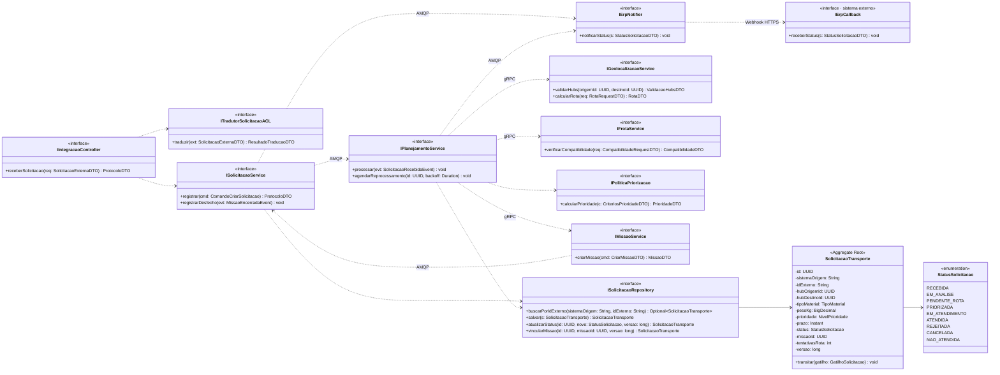
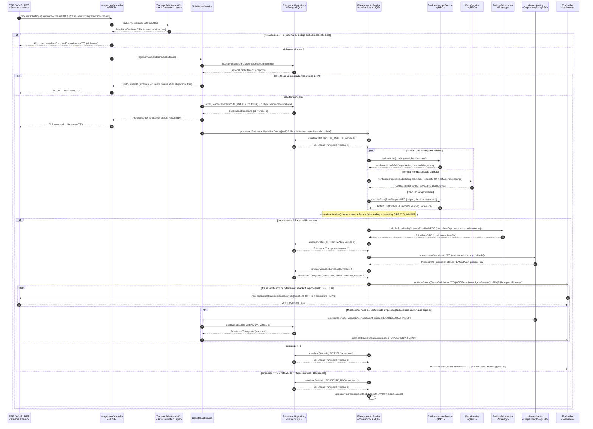
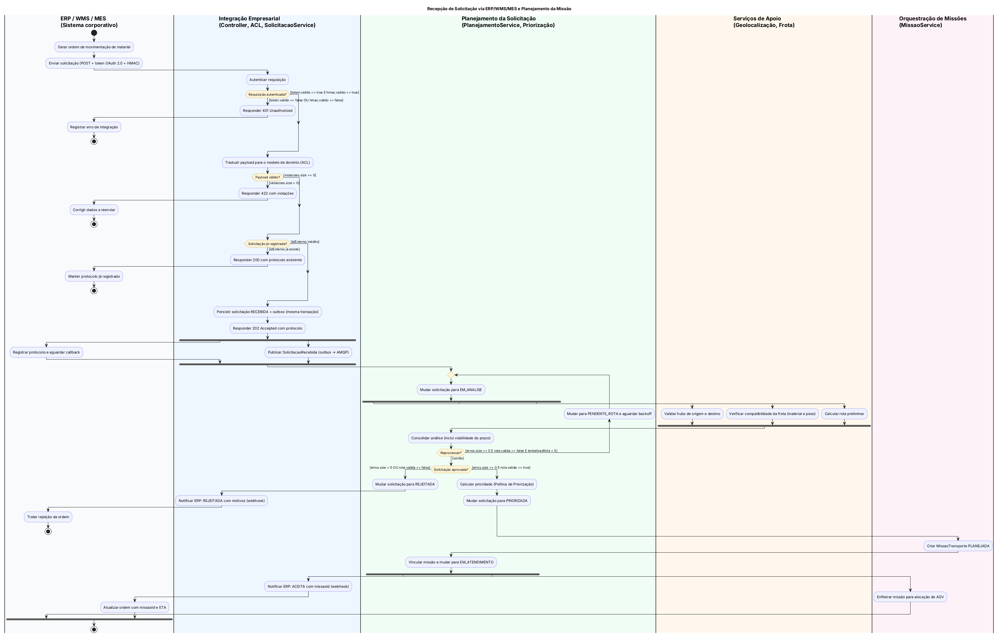
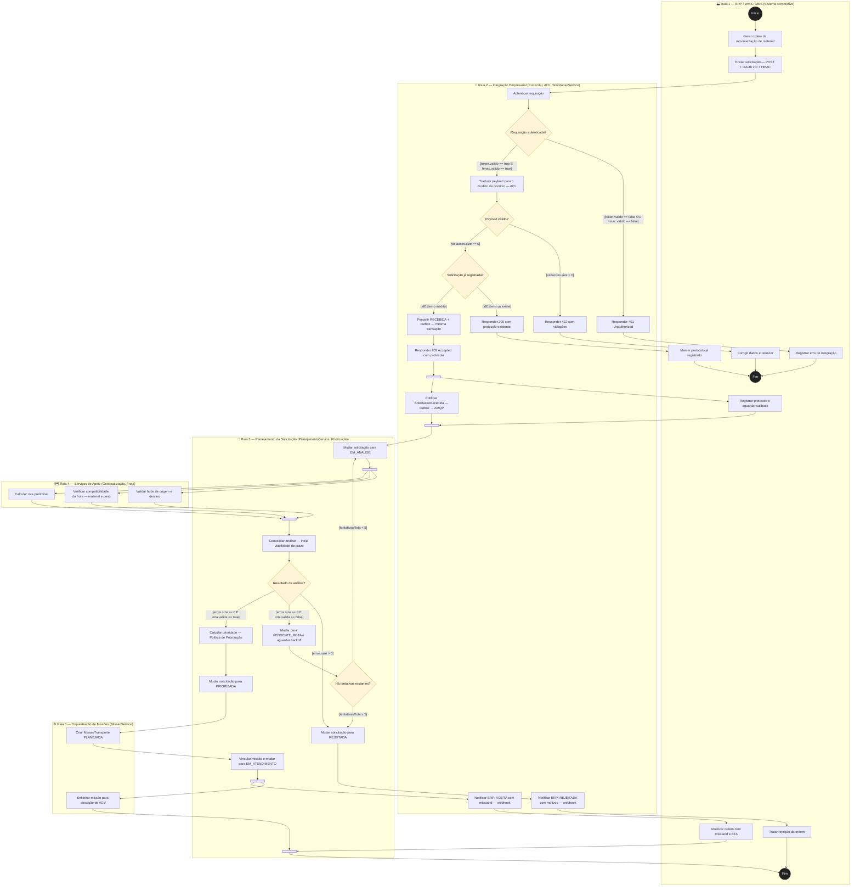
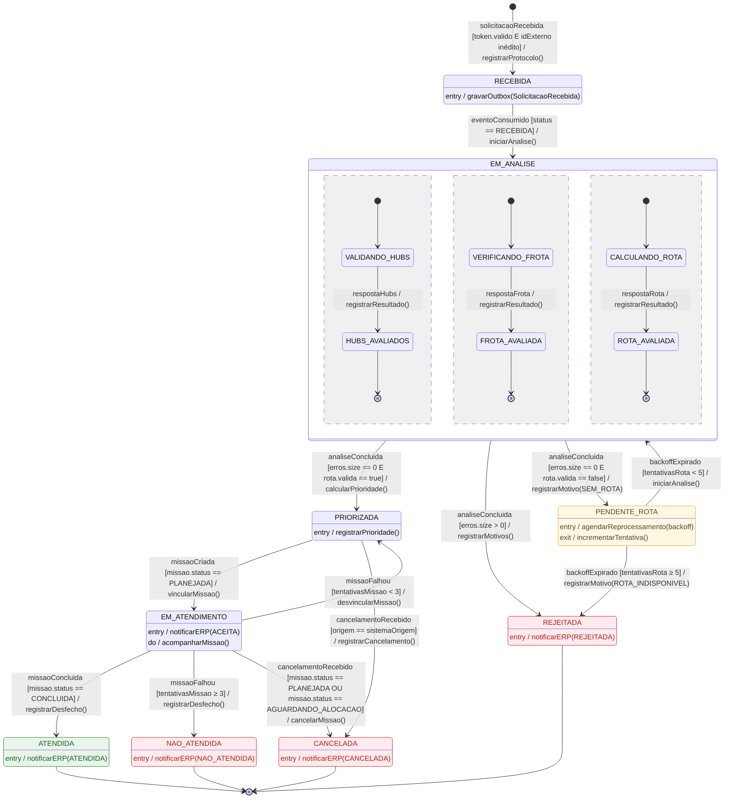
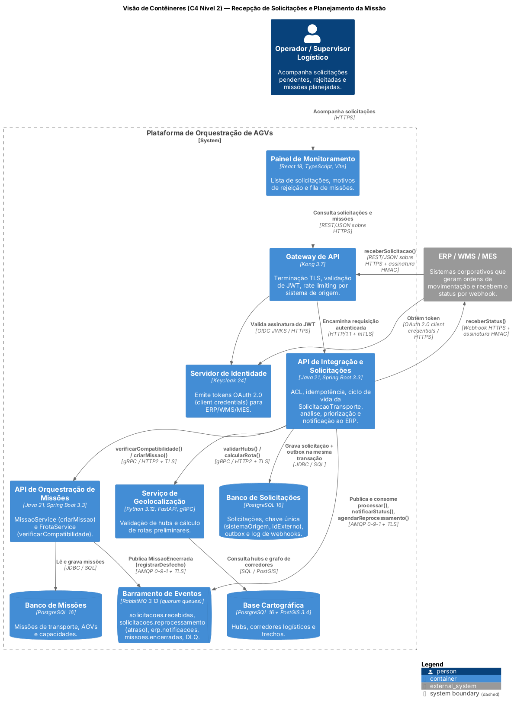
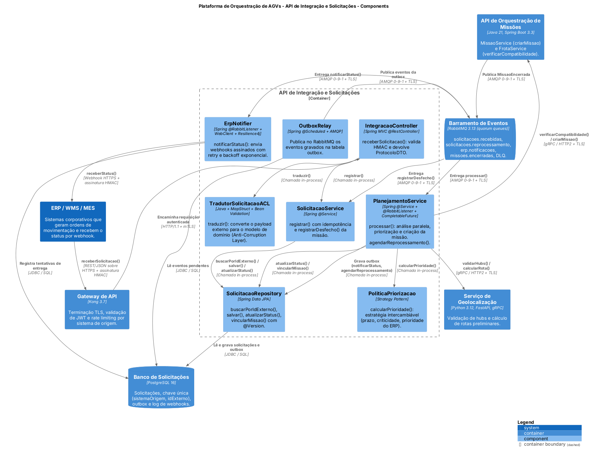

# Dossiê de Arquitetura Viva — Recepção de Solicitação via ERP/WMS/MES e Planejamento da Missão

> **APS 2 — Modelagem de Software · Engenharia de Software**
> **Projeto da equipe:** Logística de Entregas Autônomas em Parques Industriais (Orquestração de AGVs)
> **Contexto delimitado:** Integração Empresarial e Solicitação de Transporte
> **Entidade de domínio principal:** `SolicitacaoTransporte`
> **Autora:** Laura Rosa
> **Paradigma:** Diagrams-as-Code (Mermaid, PlantUML) + Models-as-Code (C4-PlantUML, Structurizr DSL)

---

## Sumário

1. [A funcionalidade crítica](#1-a-funcionalidade-crítica)
2. [Contrato de operações (base da consistência)](#2-contrato-de-operações-base-da-consistência)
3. [Artefato 1 — Diagrama de Sequência](#3-artefato-1--diagrama-de-sequência)
4. [Artefato 2 — Diagrama de Atividades com Raias](#4-artefato-2--diagrama-de-atividades-com-raias)
5. [Artefato 3 — Diagrama de Transição de Estados](#5-artefato-3--diagrama-de-transição-de-estados)
6. [Artefato 4 — Visão Arquitetural C4](#6-artefato-4--visão-arquitetural-c4)
7. [Artefato 5 — ADR 0001](#7-artefato-5--adr-0001)
8. [Matriz de consistência entre modelos](#8-matriz-de-consistência-entre-modelos)
9. [Concorrência e proteção contra estados inválidos](#9-concorrência-e-proteção-contra-estados-inválidos)
10. [Estrutura do repositório e como renderizar](#10-estrutura-do-repositório-e-como-renderizar)

---

## 1. A funcionalidade crítica

**Recepção de Solicitação via ERP/WMS/MES e Planejamento da Missão.** É a porta de entrada de todo o fluxo logístico. Segundo a Visão de Domínio, a **Solicitação de Transporte** "é a entidade que inicia o fluxo logístico". Sem ela, nenhuma missão existe e nenhum AGV se move.

| Por que é crítica | Referência na Visão de Domínio |
|---|---|
| Uma ordem reenviada pelo ERP não pode virar duas missões e dois AGVs para a mesma carga. | Seção 8.2 **Integração Empresarial** · Regra de **Exclusividade** |
| O núcleo de orquestração deve ficar desacoplado dos formatos de ERP/WMS/MES. | Seção 2 **Contextos Delimitados** · Seção 8.2 ("mantendo o núcleo desacoplado") |
| Só podem ser aceitas solicitações com hubs válidos, material compatível e peso dentro da capacidade da frota. | Regras de **Capacidade** e **Compatibilidade** · Seção 3.6 **Hub Logístico** |
| Uma solicitação crítica pode passar à frente das que já estão na fila. | Política de **Priorização** |
| O ERP precisa saber se a ordem foi aceita, rejeitada ou atendida. | Seção 8.2 (devolve status e conclusão) · Seção 9 **Rastreabilidade** |

### Fluxo resumido

1. O ERP/WMS/MES obtém um token OAuth 2.0 e envia a solicitação assinada (HMAC).
2. A **Anti-Corruption Layer** traduz o *payload* para o modelo de domínio. Erros estruturais retornam **422** na hora.
3. A **chave de idempotência** `(sistemaOrigem, idExterno)` detecta reenvios, que retornam **200** com o protocolo existente.
4. Uma solicitação nova é gravada como `RECEBIDA` junto com o evento na **outbox** (mesma transação), e o ERP recebe **202 Accepted** com o protocolo.
5. **De forma assíncrona**, o `PlanejamentoService` passa a solicitação para `EM_ANALISE` e executa **em paralelo**: validação dos hubs, compatibilidade da frota e cálculo da rota preliminar.
6. Resultado da análise:
   - **aprovada:** a solicitação é priorizada, a `MissaoTransporte` é criada como `PLANEJADA` e a solicitação passa a `EM_ATENDIMENTO`;
   - **rejeitada:** a solicitação passa a `REJEITADA`, com os motivos;
   - **sem rota:** a solicitação passa a `PENDENTE_ROTA` e é reprocessada com *backoff*.
7. O ERP é notificado por **webhook** com retry. Mais tarde, quando a missão termina, a solicitação passa a `ATENDIDA` e o ERP é avisado novamente.

### Principais DTOs

| DTO | Campos relevantes |
|---|---|
| `SolicitacaoExternaDTO` | Formato do ERP: `codDeposito`, `codMaterial`, `qtd`, `unidade`, `prioridadeErp`, `dataLimite`, `idExterno` |
| `ResultadoTraducaoDTO` | `comando: ComandoCriarSolicitacao`, `violacoes[]` |
| `ComandoCriarSolicitacao` | Formato do domínio: `sistemaOrigem`, `idExterno`, `hubOrigemId`, `hubDestinoId`, `tipoMaterial`, `pesoKg`, `prioridade`, `prazo` |
| `ProtocoloDTO` | `protocolo`, `status`, `duplicada`, `recebidaEm` |
| `ValidacaoHubsDTO` | `origemAtivo`, `destinoAtivo`, `erros[]` |
| `CompatibilidadeDTO` | `agvsCompativeis`, `erros[]` |
| `RotaDTO` | `trechos[]`, `distanciaM`, `etaSeg`, `rotaValida` |
| `PrioridadeDTO` | `nivel`, `score`, `furaFila` |
| `MissaoDTO` | `missaoId`, `status`, `posicaoFila` |
| `StatusSolicitacaoDTO` | `protocolo`, `idExterno`, `status`, `missaoId`, `motivos[]`, `etaPrevisto`, `eventId` |

---

## 2. Contrato de operações (base da consistência)

> **Regra de Consistência:** toda mensagem enviada a uma linha de vida B no Diagrama de Sequência corresponde a uma operação pública declarada na classe/interface B abaixo. Isso foi verificado automaticamente: **23 mensagens, 0 inconsistências**.



---

## 3. Artefato 1 — Diagrama de Sequência

📄 Fonte: [`docs/diagrams/sequencia.mmd`](docs/diagrams/sequencia.mmd)

| Notação | Significado | Exemplos no diagrama |
|---|---|---|
| `->>` (seta cheia) | Chamada **síncrona bloqueante** | `receberSolicitacao()`, `traduzir()`, `registrar()`, `validarHubs()` (gRPC), `criarMissao()` (gRPC), `receberStatus()` (webhook) |
| `-)` (seta aberta) | Mensagem **assíncrona / mensageria** | `processar()` (AMQP via outbox), `notificarStatus()` (AMQP), `agendarReprocessamento()` (fila com atraso), `registrarDesfecho()` (AMQP) |
| `-->>` (tracejada) | **Retorno com DTO** | `ResultadoTraducaoDTO`, `ProtocoloDTO`, `RotaDTO`, `PrioridadeDTO`, `MissaoDTO` |

**Fragmentos combinados usados:**
- `alt/else`: *payload* inválido × válido; reenvio × solicitação inédita; aprovada × rejeitada × sem rota.
- `par`: as três validações da análise, executadas em paralelo.
- `loop`: retry do webhook com *backoff* exponencial.
- `opt`: desfecho da missão, que chega mais tarde.



---

## 4. Artefato 2 — Diagrama de Atividades com Raias

📄 Fontes: [`docs/diagrams/atividades.puml`](docs/diagrams/atividades.puml) (PlantUML, **versão canônica**) e [`docs/diagrams/atividades.mmd`](docs/diagrams/atividades.mmd) (Mermaid, equivalente).

> **Por que duas versões?** O Mermaid não tem raias (swimlanes) nativas; elas são simuladas com `subgraph`, e o layout fica difícil de ler. O PlantUML tem raias verdadeiras e barras de fork/join formais. As duas versões contêm as mesmas ações, guardas e barras de sincronização.

**Raias (5):** ERP/WMS/MES · Integração Empresarial · Planejamento da Solicitação · Serviços de Apoio (Geolocalização, Frota) · Orquestração de Missões.

**Nós de decisão com guardas mutuamente exclusivas:**

| Decisão | Guardas |
|---|---|
| Requisição autenticada? | `[token.valido == true E hmac.valido == true]` / `[token.valido == false OU hmac.valido == false]` |
| Payload válido? | `[violacoes.size == 0]` / `[violacoes.size > 0]` |
| Solicitação já registrada? | `[idExterno já existe]` / `[idExterno inédito]` |
| Resultado da análise? | `[erros.size > 0]` / `[erros.size == 0 E rota.valida == false]` / `[erros.size == 0 E rota.valida == true]` |
| Há tentativas restantes? | `[tentativasRota < 5]` / `[tentativasRota ≥ 5]` |

**Concorrência (3 pares de Fork/Join):**

- **Fork 1 / Join 1:** o *ERP registra o protocolo e aguarda o callback* ‖ a *Integração publica `SolicitacaoRecebida` (outbox → AMQP)*. Mostra o desacoplamento temporal entre os dois sistemas.
- **Fork 2 / Join 2:** *Validar hubs* ‖ *Verificar compatibilidade da frota* ‖ *Calcular rota preliminar*. A consolidação só acontece depois que as três terminam.
- **Fork 3 / Join 3:** *Enfileirar missão para alocação de AGV* ‖ *Notificar o ERP (ACEITA) → ERP atualiza a ordem*.



<details>
<summary><b>Versão Mermaid (renderizada nativamente pelo GitHub)</b></summary>



</details>

---

## 5. Artefato 3 — Diagrama de Transição de Estados

📄 Fonte: [`docs/diagrams/estados.mmd`](docs/diagrams/estados.mmd) · Entidade: **`SolicitacaoTransporte`** (agregado raiz)

- **Estado inicial** `[*]` → `RECEBIDA`.
- **Superestado composto** `EM_ANALISE`, com **3 regiões concorrentes** (subestados `VALIDANDO_HUBS → HUBS_AVALIADOS`, `VERIFICANDO_FROTA → FROTA_AVALIADA` e `CALCULANDO_ROTA → ROTA_AVALIADA`). É o equivalente, na máquina de estados, do Fork 2 / Join 2 das Atividades e do `par` da Sequência.
- **Estados terminais:** `ATENDIDA`, `REJEITADA`, `CANCELADA` e `NAO_ATENDIDA` (todos → `[*]`).
- **Ações internas** (`entry /`, `do /`, `exit /`) em `RECEBIDA`, `PENDENTE_ROTA` (entry e exit), `PRIORIZADA`, `EM_ATENDIMENTO` (entry e do) e nos quatro terminais.
- **Sintaxe formal `Gatilho [Guarda] / Efeito()`** em todas as transições externas. Exemplos:
  - `solicitacaoRecebida [token.valido E idExterno inédito] / registrarProtocolo()`
  - `analiseConcluida [erros.size == 0 E rota.valida == true] / calcularPrioridade()`
  - `backoffExpirado [tentativasRota ≥ 5] / registrarMotivo(ROTA_INDISPONIVEL)`
  - `cancelamentoRecebido [missao.status == PLANEJADA OU missao.status == AGUARDANDO_ALOCACAO] / cancelarMissao()`



---

## 6. Artefato 4 — Visão Arquitetural C4

📄 Fontes:
- [`docs/architecture/c4-containers.puml`](docs/architecture/c4-containers.puml): **C4-PlantUML**, Visão de Contêineres (Nível 2). É o artefato exigido.
- [`docs/architecture/workspace.dsl`](docs/architecture/workspace.dsl): **Structurizr DSL** (Models-as-Code) com o mesmo modelo, contendo a visão de Contêineres (N2) e a visão de **Componentes (N3) da API de Integração e Solicitações**. Validado com `structurizr-cli validate`.

Cada contêiner informa sua **tecnologia** (React 18, Kong 3.7, Keycloak 24, Java 21/Spring Boot 3.3, Python 3.12/FastAPI, PostgreSQL 16, PostGIS 3.4, RabbitMQ 3.13), e cada conector informa seu **protocolo** (HTTPS + HMAC, OAuth 2.0, OIDC JWKS, mTLS, gRPC/HTTP2, AMQP 0-9-1, JDBC, webhook HTTPS).

### C4 Nível 2 — Contêineres (C4-PlantUML)



### C4 Nível 3 — Componentes da API de Integração e Solicitações (gerado a partir do `workspace.dsl`)

| Componente | Responsabilidade |
|---|---|
| `IntegracaoController` | Recebe `receberSolicitacao()` e valida a assinatura HMAC |
| `TradutorSolicitacaoACL` | Anti-Corruption Layer: traduz o formato do ERP para o modelo de domínio |
| `SolicitacaoService` | Registra a solicitação com idempotência e registra o desfecho da missão |
| `PlanejamentoService` | Faz a análise paralela, a priorização, a criação da missão e o reprocessamento |
| `PoliticaPriorizacao` | *Strategy* da Política de Priorização |
| `SolicitacaoRepository` | Persistência com lock otimista (`@Version`) e outbox |
| `OutboxRelay` | Publica no RabbitMQ os eventos gravados na outbox |
| `ErpNotifier` | Envia o webhook `receberStatus()` com retry e DLQ |



---

## 7. Artefato 5 — ADR 0001

📄 [`docs/architecture/adr-0001.md`](docs/architecture/adr-0001.md)

**ADR 0001 — Recepção assíncrona de solicitações com Anti-Corruption Layer, idempotência e Transactional Outbox (202 Accepted + Webhook).** Status: **Aprovado**.

Em resumo, a recepção acontece em duas fases:
- **síncrona (menos de 200 ms):** autentica, traduz pela ACL, verifica a idempotência, grava com outbox e responde **202**;
- **assíncrona:** faz a análise paralela, a priorização e a criação da missão, e informa o resultado ao ERP por **webhook** com retry.

A decisão protege o domínio dos formatos externos, impede missões duplicadas e garante que nenhum evento se perca.

---

## 8. Matriz de consistência entre modelos

| # | Mensagem (Sequência) | Ação (Atividades) / Raia | Transição (Máquina de Estados) | Contêiner (C4) |
|---|---|---|---|---|
| 1 | `ERP→CTL receberSolicitacao()` | Enviar solicitação / ERP → Autenticar requisição / Integração | Gatilho `solicitacaoRecebida` (guarda `token.valido`) | ERP → Kong → API de Integração |
| 2 | `CTL→ACL traduzir()` + `alt violacoes` | Traduzir payload (ACL) + decisão "Payload válido?" | — (nenhum estado é criado se o *payload* for inválido) | API de Integração (`TradutorSolicitacaoACL`) |
| 3 | `SVC→REP buscarPorIdExterno()` + `alt` reenvio | Decisão "Solicitação já registrada?" | Guarda `[idExterno inédito]` da transição inicial | API de Integração → PostgreSQL 16 |
| 4 | `SVC→REP salvar(RECEBIDA + outbox)` | Persistir RECEBIDA + outbox | `[*] → RECEBIDA / registrarProtocolo()` · `entry / gravarOutbox()` | API de Integração → Banco de Solicitações |
| 5 | `CTL-->>ERP 202` + `SVC-)PLN processar()` | **Fork 1**: Registrar protocolo ‖ Publicar SolicitacaoRecebida | `RECEBIDA → EM_ANALISE : eventoConsumido` | Outbox → RabbitMQ → `PlanejamentoService` |
| 6 | `PLN→REP atualizarStatus(EM_ANALISE)` | Mudar solicitação para EM_ANALISE / Planejamento | Entrada no superestado `EM_ANALISE` | API de Integração → PostgreSQL 16 |
| 7 | `par` `validarHubs()` ‖ `verificarCompatibilidade()` ‖ `calcularRota()` | **Fork 2 / Join 2** / Serviços de Apoio | 3 regiões concorrentes de `EM_ANALISE` | API de Integração → Geolocalização e Orquestração (gRPC) |
| 8 | `Note consolidarAnalise()` + `alt` com 3 ramos | Consolidar análise + decisão "Resultado da análise?" | 3 transições `analiseConcluida [...]` | API de Integração |
| 9 | `PLN→PRI calcularPrioridade()` + `atualizarStatus(PRIORIZADA)` | Calcular prioridade + Mudar para PRIORIZADA | `EM_ANALISE → PRIORIZADA / calcularPrioridade()` | API de Integração (`PoliticaPriorizacao`) |
| 10 | `PLN→MIS criarMissao()` | Criar MissaoTransporte PLANEJADA / Orquestração | Gatilho `missaoCriada [missao.status == PLANEJADA]` | API de Integração → API de Orquestração (gRPC) |
| 11 | `PLN→REP vincularMissao()` | Vincular missão e mudar para EM_ATENDIMENTO | `PRIORIZADA → EM_ATENDIMENTO / vincularMissao()` | API de Integração → PostgreSQL 16 |
| 12 | `PLN-)NTF notificarStatus(ACEITA)` + `loop` `NTF→ERP receberStatus()` | **Fork 3**: Notificar ERP (ACEITA) ‖ Enfileirar missão | `EM_ATENDIMENTO : entry / notificarERP(ACEITA)` | RabbitMQ → `ErpNotifier` → ERP (webhook) |
| 13 | `else erros.size > 0` → `REJEITADA` + `notificarStatus(REJEITADA)` | Mudar para REJEITADA → Notificar ERP: REJEITADA | `EM_ANALISE → REJEITADA [erros.size > 0]` · `entry / notificarERP(REJEITADA)` | API de Integração → ERP |
| 14 | `else rota.valida == false` → `PENDENTE_ROTA` + `PLN-)PLN agendarReprocessamento()` | Mudar para PENDENTE_ROTA + decisão "Há tentativas restantes?" | `EM_ANALISE → PENDENTE_ROTA` · `PENDENTE_ROTA → EM_ANALISE [tentativasRota < 5]` | RabbitMQ (`solicitacoes.reprocessamento`) |
| 15 | `opt` `MIS-)SVC registrarDesfecho()` → `ATENDIDA` | (após o atendimento da missão) | `EM_ATENDIMENTO → ATENDIDA : missaoConcluida` | API de Orquestração → RabbitMQ → API de Integração |

---

## 9. Concorrência e proteção contra estados inválidos

| Risco | Mecanismo de proteção | Onde aparece nos modelos |
|---|---|---|
| O ERP reenvia a mesma ordem (timeout) e gera duas missões | Índice `UNIQUE (sistema_origem, id_externo)` + `buscarPorIdExterno()` antes de gravar. Se duas requisições chegarem ao mesmo tempo, a violação da chave única vira resposta **200** com o protocolo existente. | Sequência (`alt` reenvio) · Atividades (decisão) · Estados (guarda `idExterno inédito`) |
| Solicitação gravada, mas evento não publicado (ou o contrário) | **Transactional Outbox** + `OutboxRelay`. | Sequência (`salvar + outbox`) · Estados (`entry / gravarOutbox`) · C4 N3 · ADR |
| O mesmo evento é consumido duas vezes (AMQP entrega "pelo menos uma vez") | A guarda `[status == RECEBIDA]` em `eventoConsumido` faz o segundo consumo virar no-op. Lock otimista em `atualizarStatus(id, novo, versao)`. | Estados · Sequência (parâmetro `versao`) |
| As 3 validações paralelas gravam resultados ao mesmo tempo | Os resultados são agregados em memória (`CompletableFuture.allOf`) e há **uma única** transição `analiseConcluida` após o Join. Nenhuma região altera o status sozinha. | Atividades (Join 2) · Estados (regiões concorrentes → transição única) |
| Cancelamento do ERP chega durante a criação da missão | Lock otimista: a transação perdedora recebe `OptimisticLockException` e é reavaliada contra o novo estado. A guarda de `cancelamentoRecebido` só permite cancelar se a missão ainda não saiu da fila. | Estados (guardas de cancelamento) |
| Transição não prevista (ex.: `REJEITADA → PRIORIZADA`) | `SolicitacaoTransporte.transitar()` valida a tabela de transições e lança `TransicaoInvalidaException`. Estados terminais não têm transição de saída. | Estados · Interfaces (`transitar`) |
| Webhook do ERP fora do ar | Retry com *backoff* exponencial (5 tentativas) e depois DLQ + alerta ao operador. O status no banco não depende da entrega do webhook. | Sequência (`loop`) · ADR |
| Corredor bloqueado temporariamente | `PENDENTE_ROTA` com até 5 reprocessamentos antes de rejeitar. | Sequência · Atividades (laço) · Estados |

---

## 10. Estrutura do repositório e como renderizar

```
aps2-laura-rosa/
├── docs/
│   ├── architecture/
│   │   ├── workspace.dsl          <-- Structurizr DSL (C4 N2 + N3), validado
│   │   ├── c4-containers.puml     <-- C4-PlantUML (Visão de Contêineres)
│   │   └── adr-0001.md            <-- Registro de Decisão Arquitetural
│   └── diagrams/
│       ├── sequencia.mmd          <-- Mermaid — Diagrama de Sequência
│       ├── atividades.mmd         <-- Mermaid — Diagrama de Atividades
│       ├── atividades.puml        <-- PlantUML — Diagrama de Atividades (raias estritas)
│       ├── estados.mmd            <-- Mermaid — Máquina de Estados
│       ├── interfaces.mmd         <-- Mermaid — Contrato de operações públicas
│       └── img/                   <-- PNGs gerados a partir dos fontes acima
└── README.md
```

**Renderização:**

```bash
# Mermaid
npx -y @mermaid-js/mermaid-cli -i docs/diagrams/sequencia.mmd -o docs/diagrams/img/sequencia.png -b white

# PlantUML / C4-PlantUML (stdlib C4 já vem embutida no plantuml.jar)
java -jar plantuml.jar -tpng -o img docs/diagrams/atividades.puml
java -jar plantuml.jar -tpng -o ../diagrams/img docs/architecture/c4-containers.puml

# Structurizr DSL
structurizr-cli validate -workspace docs/architecture/workspace.dsl
structurizr-cli export   -workspace docs/architecture/workspace.dsl -format plantuml/c4plantuml
```

Todos os fontes foram compilados sem erros com Mermaid CLI 11.16, PlantUML 1.2024.7 e Structurizr CLI 2024.07.03.
